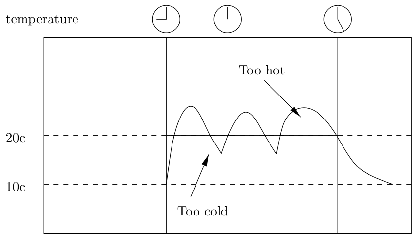
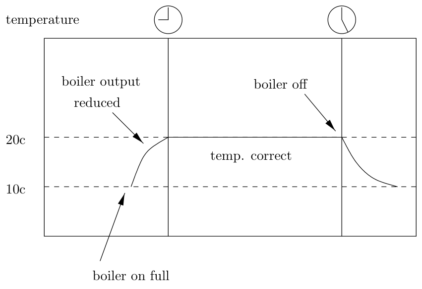

[← Chapter 3: Work, Time and Computers](03_Work_Time_and_Computers.md) · [↑ Contents](README.md) · [Chapter 5: Strategic Planning →](05_Strategic_Planning.md)

---

# Chapter 4. Basic Concepts of Planning

The idea of economy-wide planning is not fashionable. Surveying the current state of the world, one could easily get the impression that economic planning is an idea whose time has passed. Economic growth has faltered in the USA after Reagan and in the UK after Thatcher, and advocates of the untramelled market have less grounds for self-confidence than they appeared to in the 1980s, but on the other side of what used to be the ‘iron curtain’ the collapse of the Soviet-style planned economies is all but complete. Even if capitalism is visibly flawed, planning seems to offer no alternative. The self-confidence of socialists is at an historic low.

We are swimming against the tide, but, we believe, with good reason. The ‘failure’ of economic planning in the traditional Soviet mode was not illusory, but we have two counter-arguments to make. First, the system which has been abandoned in Russia was one particular implementation of planning. It was a system shaped by the needs of military production in a state caught in an arms race, starting from a level of economic development far below that of its enemies—initially Germany then the USA. The arms race and its associated trade embargoes were part of an open and deliberate US policy to bankrupt the USSR. The militarised structure of the Soviet economy was no more an essential feature of socialism than is the militarisation of the economy of Israel an essential feature of capitalism. Other models are possible, and we wish to present the outlines of a system which can be efficient in satisfying consumers’ wishes while at the same time guiding the economy towards equality, social justice and a sustainable place in the environment of planet Earth. Second, we see the costs of the new, thrusting capitalism as socially unacceptable, and we expect that more and more people will come to share this view. The skewing of the distribution of income, wealth and economic security towards greater inequality; the neglect of social provision and public goods; the headlong exploitation of the natural environment—all these negative legacies of the Reagan and Thatcher years will have to be redressed. We believe that a new socialist planning system is the most promising form of economy to deal with these deep-seated problems.

This chapter introduces our conception of such a new planning system. We discuss the key features of economic planning in general, and distinguish these from the features of a capitalist economy. The following chapters then set out in detail the planning mechanisms which we see as most likely to be efficient and effective. We distinguish these from the traditional ‘bureaucratic planning’ in the USSR, and show how our proposed alternative can be made to work by harnessing the remarkable powers of the latest generation of computers.

## Planning and control

Planning can be thought of as a branch of control theory, the study of regulating systems. Control theory normally deals with the control of automatic industrial plant. The process of automatic control is conventionally represented by a feedback loop; an example of such a feedback system might be a central heating controller. The goal might be to keep a workplace warm during the hours that it is occupied, say 9am to 6pm. This goal or desired temperature could be thought of as a plan target. The actual temperature of the building is the output of the plant (in this case a central heating system). The current temperature is compared with the goal and an error signal (the gap between current and desired temperature) is fed into the controller. This then controls the flow of fuel into the central boiler to regulate the temperature.

A crude central heating controller would just turn the fuel on or off depending on whether the temperature is below or above target. This would result in an erratic movement of temperature as shown in Figure 4.1.

Figure 4.1: Crude controller

In the example the heating is switched on at 9am but the place does not really get warm until 10. It then overheats for a while until the heating turns off. The building then cools down until at 11.30 the heating cuts back in, leading to overheating around 12.30. It goes on fluctuating for the rest of the day. We are all familiar with workplace heating systems like this!

The problem with this type of controller is that it lacks foresight, and does not take into account how the plant will react. A more intelligent control system would know about the plant parameters. It would know the heat output of the boiler, it would know how rapidly heat is lost through the walls and windows as a function of temperature, and it would know the specific heat of the building. Given a heating schedule, it could predict when it would have to turn the heating on to ensure that the place was warm enough by 9am. It would also calculate that by gradually turning down the boiler as the room temperature approached the target it could prevent the place getting too hot. An intelligent controller might give us a temperature graph as shown in Figure 4.2.

Figure 4.2: Intelligent controller

In this case the controller would have to be a more complex device than the simple clock and thermostat combinations in most central heating systems. It would require an internal model of the system to be controlled and a schedule of goals to be met. The controller draws up a plan to meet that schedule subject to what it knows about the system it is controlling. It turns on the heating a couple of hours early to make sure that the room is warm enough, and turns it down in time to prevent overheating. It can do this because it can use its internal model to simulate the way the real system would behave under different inputs. This ability to simulate internally the behaviour and characteristics of the system under control means that it does not operate by the trial and error process of the first controller.

There is an analogy here with the way a market economy operates. Capitalist firms respond to market signals, such as the relationship between price and cost of production. They adjust their production in response to such signals, with the general aim of maximizing profit. The control model here is the same as the dumb central heating controller: it is reactive and lacks foresight. Thus there are bound to be economic fluctuations and instabilities. Actually, the situation is worse as there is no reason to suppose that a large number of firms, each responding to different feedback signals, will display any kind of coherent goal-directed behaviour. At least with a dumb central heating system there is some clear overall goal. In a market economy there is no such overall goal. In particular consumers’ wishes can not act as a goal or control input as they are only effective when backed up by the money to purchase things. But consumer purchasing power is an internal variable of the economy, itself subject to fluctuations as a result of unemployment, conditions in the credit market, etc. It is as if the setting on the thermostat were to be affected by the fuel consumption of the boiler.

Adam Smith proposed the powerful metaphor of the ‘invisible hand’ of market forces. Supposedly the pursuit of private profit by individual firms, and private advantage by consumers, would lead to an outcome ‘as if’ the system were designed to maximise the welfare of all. Modern general equilibrium analysis has performed the useful theoretical function of showing how restrictive are the conditions required to ensure the Smithian result (see Hahn, 1984). The economic history of the twentieth century—with its episodes of mass unemployment, runaway inflation and environmental destruction—has shown more practically that the play of market forces cannot be relied upon to deliver socially desirable outcomes.

## Capitalist goals second order

If consumers’ wishes do not act as an external control input for the capitalist system, can government policies play this role? Only in a very limited sense, for the typical economic goals that capitalist governments set themselves are second-order. They are not concerned with the direct satisfaction of peoples’ wants and needs, but instead relate to features and deficiencies of the economic system itself. For instance, inflation and the Balance of Payments, two major targets of government policy, do not directly concern human needs. Inflation is a matter of what numbers we associate with goods; it is a problem of measurement. Inflation can occur under conditions of great material poverty as in China in the 1940s or in times of comparative material prosperity as in Britain in the 1970s. The rate of inflation by itself tells us nothing about the degree to which the economy is satisfying human needs. The Balance of Payments is also a second order phenomenon; it measures the degree to which the citizens and government of a country are becoming debtors or creditors of the rest of the world. This is an aggregate of contractual relations, and again it does not measure the degree to which the population’s needs are being met. This is not to say that inflation and the trade balance are unimportant, just that they are second-order problems concerned with the operation of the economic mechanism itself. This is the case with unemployment too.

Unemployment does indirectly affect the satisfaction of needs. The unemployed suffer a decline in their standard of living and, less evidently, so does the population as a whole, due to the loss of the goods that might have been made had the unemployed been in productive work. But again this is a problem that arises because of the institutional structure of the capitalist economy. People may be unemployed while needs are unmet, and while the machinery and equipment needed to meet them stands idle, because firms reckon it is unprofitable to meet these needs.

The only first-order goal that capitalist governments set for the economy is the growth rate. This does concern the aggregate ability of the economy to meet needs, but in the process of aggregation a lot can be hidden. What does a growth rate mean? ‘Real growth’ is commonly taken to be the growth of the total money value of output minus the rate of inflation. What this really means is another matter. Can it be said that if the economy grows by 5 percent then human happiness has grown by 5 percent? What if the growth has been at the expense of the quality of life, or of social equality? What if the price of that growth has been the pollution of the air and seas, and to what extent does the economic output that is being measured make a real contribution to happiness? Does growth in advertising or money-lending really increase the satisfaction of anyone other than those who directly profit from it?

## What would be first-order goals?

We favour a characterisation of socialist economic planning which centres on the capacity of the planning system to impose democratically decided objectives on the course of economic development. Let us consider the kind of politically decided objectives which a planned economy should be able to sustain.

Historically, the first objective of planning in socialist economies has been to promote a programme of crash industrialisation, itself a means of achieving collective security and an infrastructure capable of supporting rising levels of social provision and individual consumption. According to Paul Gregory’s careful investigations (1970), there can be little doubt that the planned economies were able to achieve a faster pace of industrialisation than market economies at a comparable stage of development.

For an already industrialised economy, however, the economic objectives to which socialist planning should be directed include the following.

- (1) A general rise in the cultural level and living standards of the people, with emphasis on those of the working class for as long as a distinct ‘working class’ continues to exist. This involves the extension, and improvement in the quality, of social provision (collective consumption); the development of choice and quality of consumer goods; a general reduction in working time and increase in leisure time; and the attempt to make work itself more enjoyable and personally rewarding.
- (2) The construction of a long term resource-constrained development path, i.e. a trajectory of economic development which respects environmental and ecological constraints, and does not store up intractable future problems due to resource-exhaustion or environmental destruction.
- (3) A change in the economic structure to one that ensures real economic equality between the sexes through the progressive elimination of patriarchal forms of economy.
- (4) The reduction of class, regional (and in less developed economies, town versus country) inequalities.

These are obviously rather general goals (although they are more specific than the typical economic goals of capitalist governments). They must be further specified in the course of constructing an operational plan, and the next section examines various aspects of this process.

## Levels of planning

Planning decisions may be broken down into three levels: macroeconomic planning, strategic planning, and detailed production planning. The connection between these levels is as follows.

First, a *macroeconomic plan* sets certain general parameters governing the evolution of the economy over time. Specifically, it concerns the breakdown of total production (or as we would prefer to express it, the breakdown of total labour time) between various highly aggregated categories of end use. How much of society’s labour should be devoted to the production of consumer goods? How much to the provision of social goods such as health, education or socialised child-care? How much to the accumulation of means of production to augment the future productive capacity of the economy? And how much (if any) to the repayment of foreign debt or the acquisition of foreign assets? A macroeconomic plan must answer these questions. It must also address the question of how intensively the economy’s given productive capacity should be exploited. The answer here is not necessarily ‘to the maximum’, although that will be the answer during wartime. A capitalist government may, for instance, decide to reduce aggregate demand and generate unemployment in order to reduce the rate of inflation—this is macroeconomic planning of a kind. A socialist planning agency will have no interest in creating unemployment, but equally it will not wish to work the population as hard as possible. There is a trade-off between productive labour and leisure time, and the macroeconomic planners will have to take into account the people’s preferences in this respect, when calculating how much labour time is available for the various uses.

Second, the *strategic plan* concerns the changing industrial structure of the economy. Given that so much of the available labour-time is to be devoted to public provision, so much to consumer goods and so much to producer goods, which particular sectors should be developed, exploiting which technologies? Which types of goods should be imported, because they can be produced more cheaply elsewhere? Which industries should be phased out over the long run? In the context of strategic planning, issues such as the environmental impact of various industries and technologies, and the appropriate criteria for assessing potential investment projects, must be addressed.

Third, within the framework established by the macroeconomic and strategic industrial plans, *detailed production planning* concerns the precise allocation of resources: Which specific types of goods are to be produced in what quantities, using how much labour, and in which locations? Which productive units are to receive inputs from which others? And so on.

Governments in capitalist economies are able to carry out some degree of macroeconomic and strategic industrial planning (outside of wartime, they obviously do not attempt detailed production planning). But since these governments do not have property rights over the principal means of production, their ability to plan is limited, and depends on the co-operation of capitalist enterprises and other private agents. Consider macroeconomic planning. Governments may, for instance, expand the money supply and lower interest rates with the intention of stimulating investment spending, causing a reallocation of resources in favour of accumulation of means of production. But if capitalist enterprises do not see investment as sufficiently profitable, low interest rates may fail to make much difference. Or again, a government may cut taxes in the hope of increasing total output and employment, but if the consumers who benefit from the tax break choose to spend their gains on imported goods the result may be a trade deficit rather than domestic expansion.

As for strategic industrial planning in a capitalist economy, the striking success story is the Japanese Ministry of International Trade and Industry. The MITI has been able to foster a far-sighted adjustment of the structure of Japanese industry in the face of a changing pattern of world production and competitive advantage. Those industries which, in the calculation of MITI, offered the best prospect of long-run competitive growth were built up with the aid of state-funded research and development. One of the better accounts of this process is contained in Keith Smith (1986). The success of MITI has proved hard to emulate; it depends on the willingness of capitalist enterprises in Japan to co-operate with the Ministry, and a co-operative climate of industry-government relations cannot be legislated into existence.

In principle a socialist government, with property rights over the means of production, should be in a much better position to carry out coherent and effective macroeconomic and strategic industrial planning. The fact that such a government has the power to shape these aspects of the economy does not, of course, guarantee that this power will be used wisely. But if the planning process is open to debate, democratic whenever possible, and systematically calls upon the best efforts of the scientific community, there is good reason to hope that the results will be superior to those of the capitalist market.

The next five chapters develop the concept of planning in various ways. Chapter 5 elaborates the issues involved in strategic planning; chapter 6 sets out the requirements for effective detailed planning. Macroeconomic planning is discussed in chapter 7, and the marketing of consumer goods in chapter 8. Chapter 9 examines the issue of the informational requirements for the planning process as a whole.

---

[← Chapter 3: Work, Time and Computers](03_Work_Time_and_Computers.md) · [↑ Contents](README.md) · [Chapter 5: Strategic Planning →](05_Strategic_Planning.md)
