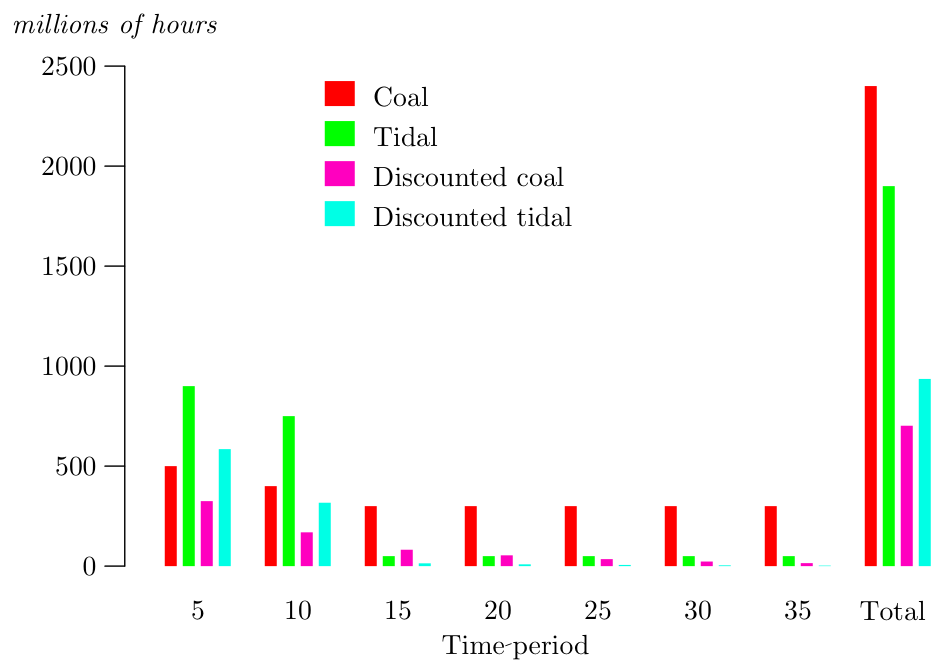

[← Chapter 4: Basic Concepts of Planning](04_Basic_Concepts_of_Planning.md) · [↑ Contents](README.md) · [Chapter 6: Detailed Planning →](06_Detailed_Planning.md)

---

# Chapter 5. Strategic Planning

We use strategic planning as something of a portmanteau term. This chapter examines a number of aspects of planning, mainly relating to the overall structure of the economy, which do not naturally fall under the headings of macroeconomic or detailed production planning (the latter are dealt with in separate chapters). The main topics to be covered here are

- (1) The planning of the industrial structure
- (2) Environmental considerations
- (3) Investment planning and the time dimension of production
- (4) Planning of the mode of distribution of goods and services
- (5) Agricultural production planning

## Planning the industrial structure

There are a number of areas where long term politically determined objectives for production can be realistically envisaged: housing, transport, energy supply, communications, tourism, industrial restructuring. In each of these cases, ‘lumpy’ decisions have to be taken. For instance, the shape and form of new housing developments are properly a matter for democratic debate and decision. Or consider the case of personal transportation.

Whether a country relies upon private cars or upon public transport is a decision which has huge long-term effects upon a society. And this is a case where the sum of individual private decisions does not necessarily correspond to a socially optimal result. When transport in great industrial cities relied upon the train and the tram, speeds of travel through city centres were higher than they are now. For those who could afford them, the new private cars offered a speed advantage over the tram, since cars did not stop to pick up passengers. But as more and more cars came onto the roads congestion increased, and both cars and public transport got slower as a result. At all times the private car continued to offer a speed advantage over public road transport, so each individual retained an incentive to go by car. Rising car use took trade away from the buses and trams and services became worse. The end result is dangerous and congested roads, air pollution and longer journey times. Here is an example where a social decision on the shape of the economy may produce results far superior to the aggregate of private decisions.

A decision either to extend or restrict the use of cars has major industrial implications. In a big country, the car industry may directly and indirectly employ millions of people making cars, making components, providing petrol, servicing, building and repairing roads. The layout of cities and the forms of retail trade are also influenced by the level of car ownership. Strategic planning should be able to take these ramifications into account in a systematic way. If a decision is made to restrict the use of private cars, the plan must call for the redeployment of the labour associated with the car industry.

The above example concerns a technology which is already well understood. A different issue for strategic industrial planning arises with new technologies. Looking back at past industrial development we can see a series of waves in which different industries played the leading role: textiles, railways, heavy engineering, chemicals, automobiles, consumer durables, electronics. The success of each industrial economy has depended upon its ability rapidly to develop these pioneer industries. The first two waves brought Britain to prominence, the third and fourth Germany, the mass production of automobiles and consumer durables was pioneered in the USA, and with electronics the lead has shifted to the Far East.

Newly industrialising economies have a comparatively easy task: they start off without an established industrial base and can put all their efforts into building up the latest industries. The USSR from the ’30s to the ’50s achieved remarkable growth rates by expanding heavy industry; forty years on Taiwan and Korea achieve similar results with the electronics industry. This type of initial industrial development is well suited to planning since the planning authorities can copy the industrial structures of the existing world leaders.

It is much more difficult for an already industrialised country to restructure and play a pioneering role. In this case there is nobody to copy. Old industries must be run down in favour of industries that may become possible on the basis of technology that has yet to be developed. This requires foresight; plans must be drawn up that project the results of present scientific research into a future in which whole new industries will rest upon them. The knowledge, technology and skills that will be required must be identified, and the research and development organisations brought into being that will convert science into technology. Education and training must be reorganised to produce a labour force that will be able to operate these new technologies. Final consumer products using these technologies must be conceived and designed. Manufacturing processes must be invented. Production equipment and components supplies must be developed, production lines created and put in motion.

If an economy is not to stagnate, this sort of restructuring must be carried out repeatedly, with restructuring plans drawn up to cover 10 or 15 year periods. It is not clear to what extent this level of planning can be democratic. The knowledge of which technologies are likely to be relevant in 10 to 20 years’ time will initially be concentrated in a small research community, and it is difficult for people without specialist knowledge to make judgements on the matter. It may be possible, however, for the technical specialists to draw up a number of feasible options for future industrial development, which could then be canvassed in public debate.

The composition of the planning bureau responsible for drawing up strategic plans must be determined according to the time-scale of the plans involved. The longest-term plans would have to be formulated by small committees of economists with research scientists on secondment from their usual work. For plans with a 5 to 7 year perspective, larger numbers of economists would have to be supported by production engineers. Shorter-term plans would have to be drawn up on the basis of a much wider input from product designers and industrial managers.

A crucial element in the success of strategic plans is their ability to harness innovation. This is an inherently paradoxical issue, since innovation, by definition, cannot be known about before it happens. However, the process of moving from a new concept to its regular industrial application takes time. Although the innovation process may be impossible to plan at the start, planning becomes more and more possible as it progresses. Any modern industrial economy needs a regular process by which the unknown is made knowable, and the knowable becomes the used. Scientific research and development become branches of the social division of labour, which, at a technical level, are relatively independent of the dominant form of ownership in the economy.

This is not to say that social relations have no bearing upon the process of innovation—clearly they do. But whether the economy is socialist or capitalist seems less important than a whole series of other factors. Innovation is a branch of the division of labour in which an economy may or may not specialise. There are many capitalist countries and they have very varied records when it comes to the industrial application of new technology. Britain is as notorious for the laggard pace of its technological innovation as Japan is acclaimed for its speed. The reasons defy simple explanation, and certainly cannot be reduced to the simple formula: The greater the market freedom, the greater the degree of innovation. Incalculable elements of national psychology and culture—a society’s attitude to the new—seem to enter into the equation.

Alongside these imponderables, identifiable objective factors play their parts: how good is a society’s education system, how much of the national income is spent supporting research, how much is spent on development? Out of the research and development budget, how much goes on civilian and how much on military research? Does the society have within it institutions that are capable of integrating all aspects of the development cycle from ‘blue skies’ research to finished product?

There are demonstrable links between the amount a society spends on education and civilian R&D and its rate of innovation. The institution of a democratic planning system, in which major divisions of the national budget like defense, education and R&D were subject to an annual popular vote, would not guarantee that society would choose to spend a large amount on R&D. The citizens might decide to give it a low priority with consequent effects for their economy, but this would be the result of a deliberate choice freely taken rather than a side effect of the narrow private decisions of company accountants.

For R&D to be effective there must be a transmission belt that spans the stages of pure research, applied research, product development, and mass production. The economic performance of Asian capitalisms seems to indicate that the later states on the transmission belt are particularly crucial. Western capitalism has had more publicly funded pure research, but an excessive portion of the applied research and product development has been oriented towards arms production. The resulting fighter aircraft and rockets have been marvels of sophistication but the capacity to innovate in the production of civilian goods has all but vanished. The UK and the USA were no better at applying new technology to video records, motorbikes or cameras than the USSR. The arms industry was the only one in which publicly funded applied research and and product development led through into production. For a socialist economy to use science to improve civil industry an absolute priority would be to create a collection of civil institutions to replace those of the military-industrial complex.

## The environment and natural resources

In chapter 4 we made reference to the need for a socialist economy to adopt an environmentally sound growth policy. This section discusses some of the specific implications of this goal, and assesses the relative merits of market and planned systems with regard to environmental issues. Some further relevant points will be developed in chapter 14, where the focus is on the kind of property relations required to ensure the careful husbanding of natural resources.

Up to this point, we have assumed that the cost of producing any good or service is adequately captured by the total human labour-time expended in its production. In a recent critique of socialist planning, Don Lavoie (1985) raises once again an old objection concerning the inadequacy of labour values for dealing with the costs of non-reproducible natural resources. The argument is that a costing in terms of labour values fails to deal with natural or non-labour inputs. In a market system, natural resources have a price-tag and enter into costs of production; under the labour theory they are free. Thus, it is argued, the labour theory will underestimate the cost of goods produced from scarce natural resources.

A serious issue is at stake here. But this argument, which originated with von Mises, can be turned against the advocates of the market, as the rational use of natural resources is capitalism’s weakest point and (potentially) socialism’s strongest.

How is the ‘free market’ price of natural resources determined? The classical answer is that it comes from differential ground rent. In that case the marginal land or oilfield or forest comes free and the cost of production at the margin[^1] comes from the labour (and in neoclassical theory, capital) inputs. But the oil from the marginal well is a depletable resource too, and in a market system this depletion has no price. There is only a finite amount of oil, but this is not recognised in its market price. Indeed what we have seen with capitalism has been a reckless destruction of natural resources wherever the resource has been at the margin. Here it is worth recalling the point that Marx makes about the American frontier, where the quality of land improved as colonists moved out of the coastal states and onto the plains. As the marginal land in geographical terms became the most productive land (which moreover could be had free as it was stolen from the Indians), all constraints on natural resource exploitation were removed. Hence agricultural practices (absence of crop rotation, monocultures) were adopted which led to rapid soil exhaustion. These characteristics, in the most market-oriented of economies, led to the catastrophic soil erosion of the dustbowl. The same holds for timber exploitation at the margins. Timber stolen from native peoples by capitalist companies is treated as a free resource on the West coast of North America or the jungles of Amazonia and Borneo, and forests that have taken thousands of years to develop are cut down in a few decades.

The only circumstance in which a market system will lead to a husbanding of land and preserve its fertility, is if there is a landowning class that derives its revenue from ground rent and has a vested interest in preserving that revenue. Technically, this presupposes a differential rent arising from diminishing returns at the margin. Politically, it presupposes that the landowning class is rich, politically sophisticated and backed by the state power. This combination only occurs under specific historical circumstances. In most parts of the world during the capitalist era the land has been held by poor peasants or hunter-gatherers with little access to political power. Their natural resources have been simply expropriated. Moreover, whether it is rational for landlords to husband a resource or to mine it, destroying soil fertility etc., will depend upon the discount rate. At any positive discount rate[^2] it makes sense to deplete non-renewable resources. At low and stable discount rates it may be economically viable to carry out investments that enhance the quality of the land, as was done by the 18th century British landlord classes, but here we are dealing with slowly renewable resources rather than non-renewable ones.

In sum, the market will in all cases waste resources at the margin whether returns are increasing or diminishing. It will husband slowly renewable resources at low discount rates in combination with diminishing marginal returns. It will always deplete non-renewable resources.

The introduction of imputed rents[^3] into a socialist economy, as was advocated by Soviet ‘reformers’, is equivalent to performing calculations of labour values using marginal rather than average costs and assuming diminishing returns to labour. But given the arguments above, imputed rents under socialism will be no more effective in husbanding resources than real rents are under capitalism. We would argue the more radical point that ecological destruction is the result of any ‘economic’ decision mechanism, i.e. any decision mechanism based upon a single objective function. Any decision procedure based upon prices fails to convey information about the ecological and environmental consequences of a course of action, since these are complex and not reducible to an accounting entry. Any non-qualitative assessment of environmental impact is misleading. The environmental consequences of a course of action have to be determined by scientific investigation and resolved by political struggle. Examples of this have been the campaigns waged by the scientific community in the USSR to stop industrial development on the shores of lake Baikal and to halt the plans to divert Siberian rivers south to irrigate Central Asia.

There is no guarantee that wise decisions will be taken on these issues. The most that can be asked for is that political conditions exist to allow free and informed debate on the issue, along with freedom of scientific investigation and publication, and that a final decision is taken by a free vote. In a capitalist country such decisions are almost invariably arrived at to suit the commercial interests of big companies who are able to buy political influence. In a socialist democracy major environmental issues should be settled by referendum after a prolonged and open debate in the media. If a hydroelectric scheme is proposed that will flood a valley which is both a beauty spot and a unique habitat it is pointless to search for some economic formula that will decide if the project should go ahead. The problem is political, not economic. That is to say, a decision requires a deliberate judgement of priorities, and cannot be reduced to a comparison of simple numbers, whether expressed in labour time or money.

The question of resource depletion is paradoxical because policies of rapid depletion and extreme conservation lead to similar results. If we use up North Sea oil in one big boom lasting a few years then future generations are deprived of it, but if we leave it in the ground permanently then again we are all deprived of the use of it. The prudent alternative is to plan to use up the oil at such a speed and in such a way as will enable us to develop substitutes before it runs out. There is little evidence to show that the market is doing this. On the other hand there was some evidence of this being done in a systematic way in the USSR. For the last thirty years the Soviets consistently devoted considerable resources to thermonuclear fusion research in the hope of developing a replacement for fossil fuels. Western machines like the Joint European Torus (JET) derive from the Soviet *Tokamak* designs. And in the course of 1987 with the launch of the new Energy heavy lift vehicles it transpired that a major objective of the Soviet space program was the development of solar energy[^4]. Projected uses of these vehicles include the placement of orbiting mirrors to provide illumination of arctic work sites during the winter months, and the construction of orbiting solar power plants to transmit microwave power back down to earth. This sort of long-term project can be undertaken by a socialist economy as part of the normal planning mechanism. The market mechanism can never do it. Capitalist countries can only compete in this area insofar as they set up special state agencies that mimic socialist planning—NASA or the CEGB.

## The time dimension of production

In our discussion of the use of labour values we have up to now assumed that a day’s work tomorrow counts for the same value as a day’s work in 10 years’ time. It may be objected that this is unrealistic and that such a system of calculation would lead to the adoption of projects that are excessively capital intensive. We can illustrate this with a concrete example. It has been proposed that a barrage be built across the estuary of the river Severn in order to generate electric power and provide a motorway link between England and Wales. This project would, once constructed, produce electricity at a very low labour cost, since the ‘fuel’ comes free in the form of an unusually high tidal oscillation of some 7 meters. But the massive civil engineering involved in the construction would cost more than the construction of coal-fired stations of equivalent output.

This is notionally shown in Figure 5.1, which compares the labour that would have to be expended over 5 year periods on the two projects. Over the whole 30 years the total labour expended to produce the same amount of electricity from coal would be greater than from the tides. But for the first 10 years of the project, during construction, the cost of coal-powered stations would be lower. If we decided how to generate electricity just on the basis of minimizing labour costs then the tidal system would be a clear winner. In fact the English electricity generating board has chosen not to build the tidal station because the interest it would have to pay on the money borrowed to build the barrage would outweigh the savings in fuel in later years. At a lower rate of interest the choice would be different. A costing of the two alternatives using only their labour content, i.e. in terms of pure labour values, is equivalent to using a zero interest or discount rate.

A zero discount rate could be argued against on both subjective and objective grounds. On the principle that jam today is better than the promise of jam tomorrow, it may be better to save effort this year even if that entails more work in the future. A subjectively determined discount rate could conceivably be set politically (with people being allowed to vote every few years on whether they wanted the discount rate raised, lowered or left the same). But a more objective approach is possible: one could use the average growth rate of productivity as the discount rate. The rationale for this is that if labour productivity doubled every decade then one hour of labour now would be equivalent to half an hour’s work by the end of the 1990s. Since we can never accurately know the future, it would be necessary to estimate future productivity growth on the basis of recent history. It may be noted that on this basis the decision of the electricity board not to proceed with the Severn barrage was economically irrational as the discount rates used in their calculations were well above the actual average rate of growth of productivity in the economy. This instance strengthens the argument that rational economic calculation will only really become possible in a socialist state.

Figure 5.1: Effects of discounting at 9% on costs of two power schemes

In capitalist economies the discount rate is determined by contingencies in the money market which are quite divorced from actual production possibilities. It is driven by speculative movements of international capital combined with undemocratic decisions of the monetary authorities; it is unstable and fluctuates from month to month. The use of such a variable in economic decision making is indefensible either on grounds of economic efficiency or democracy.[^5]

## Market and non-market distribution

One strategic decision, relating to the overall shape of the economy, concerns which goods should be allocated directly by the plan, and which should be ‘marketed’ in some sense. We envisage a fully planned allocation of producer goods, alongside a market in consumer goods. The precise nature of the latter system is spelled out in chapter 8; as we shall show, it is quite distinct from the market in capitalist economies, in that it is subordinated to a planned allocation of social labour time. But we still face the question of where exactly to draw the line between market and non-market distribution, or rather what principles to apply in deciding this point.

Four main points are relevant to this issue. We discuss these under the headings of rights of citizenship, freedom of choice, coping with scarcity, and costs of metering.

### Rights of citizenship

The first principle is that those goods and services which are basic prerequisites for full participation in the productive and communal life of the society should be provided as of right, and financed out of general taxation. Prime examples here would be education, health care and child care (we shall also argue in chapter 13 that televisions equipped with electronic voting machines should be provided as a right of citizenship, to permit full participation in political democracy). In order to function as an active, productive member of society one must be well-educated, healthy and free of the need to stay at home with dependent children all day. These goods are necessary to give individuals the ‘positive freedom’ to control their own lives.[^6] In addition, it is in the interest of society as a whole that each of its members be educated, healthy and productive; the benefits of education, health care and child care are not confined to the individual. (In the parlance of economics, there is an external benefit or ‘positive externality’ here, and it is widely recognised that markets do not produce optimal results where externalities are important.)

### Freedom of choice

The second point is that, once the basic prerequisites of citizenship are provided, individuals (or families, or communes) should have maximum freedom to decide in what form they want to enjoy the fruits of their labour. State allocation or rationing is poorly adapted to this end; we need some form of ‘market’ on which people are able to spend their labour tokens. (As mentioned above, we describe such a market in chapter 8.) This mode of distribution would be used for food, drink, entertainment, books, clothing, holiday travel and so forth—goods where ‘externalities’ are absent or unimportant. While it does not make sense for society to allow its members to fall into ignorance or unnecessary disease, or to be trapped at home with young children, it makes perfect sense to allow them to choose between caviar, wine, books, shirts or trips to the highlands.

### Coping with scarcity

Our third point concerns goods which are in relatively fixed supply, and where the demand exceeds the supply at a price of zero. Take the example of a congested stretch of motorway. New roads can be built, or an old road widened, but that takes time and may be objectionable on environmental grounds; let us suppose for the moment that the supply of motorway is effectively fixed. If no price is placed on the use of the road, it becomes so congested that nobody is able to travel fast. In this case a toll makes good sense. It is a way of ‘rationing’ the use of the scarce resource. People for whom fast individual travel is important will pay the toll, while others may decide to use public transport instead.

Tolls of this kind also provide useful information for planners. Suppose the construction of new motorway is under consideration. The construction will be costly in terms of labour time. If the existing road is overcrowded when no toll is charged, that does not of itself mean that new construction is cost-effective, but if a toll related to the cost of new construction is levied and the existing road is still overcrowded, then there may be a case for building more road (unless there are strong environmental considerations to the contrary).

The general point here is that opposition to capitalism need not imply blanket opposition to ‘market solutions’ to problems of scarcity — there may even be good grounds for putting prices on some goods which happen to be supplied ‘free’ (i.e. financed out of taxes) in the present society.

### Costs of metering

We suggested above that consumer goods which do not carry any important external effects should be marketed in exchange for labour tokens. This principle has to be qualified in some cases to allow for basic economic rationality. That is, there is no point in charging people individually for a good if the costs of metering their consumption and billing them exceed the revenue to be gained, when the good is priced at its cost of production net of these latter costs. In this light, ideological considerations apart, the privatisation of water in Britain is probably irrational. Water is a very low-cost product, and it is not at all clear that the costs of metering and billing are justified. (If clean water were to become a scarce and costly commodity, the situation would be different.)

## Agriculture

Free markets in agriculture are almost unknown in the developed world. The western governments which advocate the adoption of the free market as the solution to the food problems of Poland strenuously resist any attempt to impose it on their own countries. Food markets are strongly regulated in Japan, the European Community and the USA. The purpose of such regulation is both to ensure stability of supply, and, more importantly, to cushion the politically influential farming lobby from the rigours of the market. The methods adopted differ in detail, but the general effect is to hold food prices above free-market levels to protect farmers’ incomes.

The predictable effect of this is to encourage overproduction. Excess food is produced, which is then bought up at subsidised prices and accumulated in warehouses and grain silos. The disposition of these surpluses poses a conundrum. The simple answer would be to sell them off cheaply to consumers, but this is ruled out as it would undercut prices and harm farm incomes. Special gimmicks are resorted to. Butter is distributed to pensioners at Christmas. At Salvation Army offices squalid scenes develop as old people queue and scramble to obtain their free pound of butter. Even worse, food is destroyed. Stocks of potatoes are deliberately contaminated with purple dye to make them unfit for human consumption. Farmers are paid incentives to leave their land idle rather than grow food.

At the same time, high prices encourage farmers to put marginal land under the plow. Water meadows, hedgerows and woods vanish beneath grain prairies. At subsidised prices it becomes worthwhile to douse the land with chemicals, contaminating food, killing wildlife and poisoning water supplies with nitrates and pesticides. We reach the ultimate absurdity when landowners have to be paid not to destroy sites of scientific interest by planting conifers, which they would never have considered in the first place were it not for the incentive payments for planting trees.

What exists now in the West is a crazy amalgam of public regulation and private self-interest, all in effect devoted to the enrichment of the landowner. Despite this, apologists for this system can point to the East and say: ‘At least we don’t have food queues like they do in Russia.’ The popular picture of communist agriculture involves permanent shortages, Russian queues and Polish meat riots.

Before the collapse of Communism in the East there were wide divergences in agricultural systems. Poland had predominantly private agriculture while the Czechs across the border had socialised agriculture. Poland had butchers’ shops with bare shelves while state shops in Prague were piled with salamis and sausages.[^7] The USSR had predominantly socialised agriculture but was also notorious for shortages.

As these examples show, it is not a simple matter of private farms being better or worse than socialised farms. Other factors—pricing policy, the distribution system, and the cultural level of the countryside—all play their part. Moreover, whether shops are full or empty is a poor measure of the effectiveness of an agricultural policy. If prices are high enough, shops will always be full. There are plenty of countries in the world where full shops go alongside hungry people. Conversely, if you hold prices artificially low, shops will sell out.

A better way to judge a system of food production and distribution is to look at the nutritional standards of the population as a whole, and at the ecological effects the system produces. There is now an immense body of scientific knowledge relating to diet. Even before the second world war, nutritionists had worked out the quantities of proteins, fats, carbohydrates and vitamins needed for a balanced diet. This knowledge was put to good use in setting wartime food rations. Although traditional sources of supply were dislocated, the rational planning and allocation of what remained meant that health and nutritional standards for the population as a whole actually increased.

Some of the nutritional advice of the 1940s may seem a little dated now. Epidemiological studies into diet and heart disease have led to modern recommendations prescribing somewhat less butter and animal fats and more complex carbohydrates. But the same general principle applies: if the population as a whole consumed a diet in conformity with the latest scientific wisdom then the general standard of health would improve. It would no longer be a matter of preventing diseases like rickets or tuberculosis fostered by chronic undernourishment, but of curbing the great modern killers—cancers and heart diseases— brought on by a poor diet.

This suggests that food supplies not only can be, but ought to be, planned. For a given size and age-structure of population, total food requirements can be readily calculated. This can then be obtained from three sources: imports, socialised farms and fisheries, and private farms and fisheries. We will assume that food imports are regulated by long-term supply contracts with various producer-nations, which, barring major climatic catastrophes, provide a reliable base supply of those foods that cannot be economically produced at home.

This leaves a known target for domestic production. If we assume that the agricultural sector is made up of a mixture of state farms, co-ops and family farms, then the problem is how to achieve the target level of output from these sources. Agriculture is more affected by the weather than other industries. Its output fluctuates from year to year, and exact annual planning is impossible. But over a period of several years these fluctuations even out, and by holding buffer stocks, regular supplies can be maintained. It would be reasonable to set three or four year moving targets for agricultural output. Family farms and co-ops could be asked to tender for the supply of fixed quantities of crops over a three year period. They would be asked to specify what inputs they intended to use in terms of machinery, energy, fertilisers and so on, plus how much value-added they were going to ask for their labour. The supply contracts could then be awarded according to a formula that takes into account both the cost (in terms of direct and indirect labour) and the environmental effects that would be produced by applying the specified quantity of chemicals and fertilisers.

A tendering system would avoid the overproduction that plagues Western systems of agricultural planning. It places the needs of the consumer and the environment before that of the producer. It would encourage efficiency, and hasten the closure of marginal, uneconomic farms. The farms which win contracts would be rewarded with long term stable prices and markets.

[^1]: The concept of the margin and of marginal returns have their origin in the theory of ground rent. Here the margin represented the literal edge of cultivation. Marginal land was the last, worst land to be brought under the plough.

[^2]: A discount rate is an abstraction of the notion of a rate of interest. If, in a capitalist economy I am promised a £1000 postal order in a year’s time, this has a present value to me of somewhat less than £1000. If I want to spend the money now, not in a year’s time, I must take out a loan which I promise to repay in a year. Suppose that the credit company charges me 25% interest, then by borrowing £800 now I would be able to pay back the loan plus the £200 interest when the postal order arrives. A future income of £1000 would have discounted present value of £800. The possibility of doing this is obviously an effect of the existence of credit institutions, but capitalist economics abstracts the idea from its institutional framework and advances it as a general principle of economic calculation.

[^3]: An imputed rent in a socialist economy involves the state acting as if it were two private individuals: a landowner and an industrialist. The state as landowner charges the state as industrialist a rent for the land used by industry. Since the state owns both the land and the industry this is a purely internal accounting operation.

[^4]: See *The Times*, 10/8/87.

[^5]: It must be emphasised that the use of a discount rate in a socialist plan in no way implies the existence of a money market, loans, or the payment of interest on loans. It is merely a parameter used in the computer programs that evaluate the social costs of different production alternatives.

[^6]: On the concept of positive freedom, see Partha Dasgupta (1986).

[^7]: Bulgarian agriculture was on the Czech pattern. One of the authors visited Bulgaria during the height of the Polish Solidarity agitation during the early 1980s. His large well-fed Bulgarian hosts were openly contemptuous of the Poles: “No wonder they’re in a mess, they privatised agriculture back in ’56.”

---

[← Chapter 4: Basic Concepts of Planning](04_Basic_Concepts_of_Planning.md) · [↑ Contents](README.md) · [Chapter 6: Detailed Planning →](06_Detailed_Planning.md)
