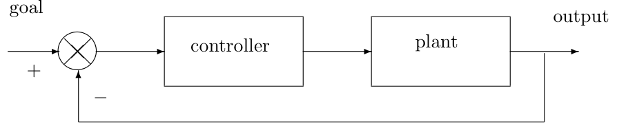
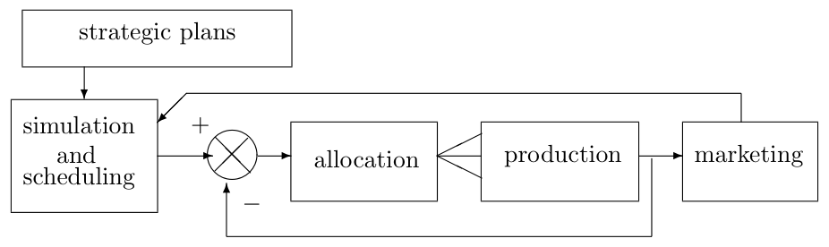
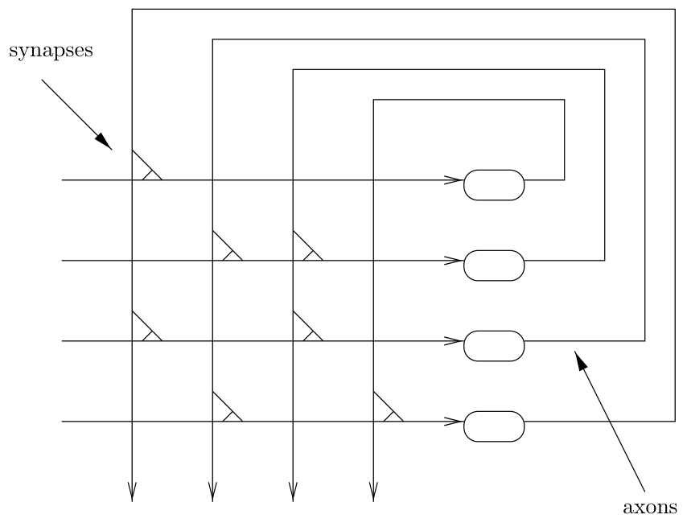
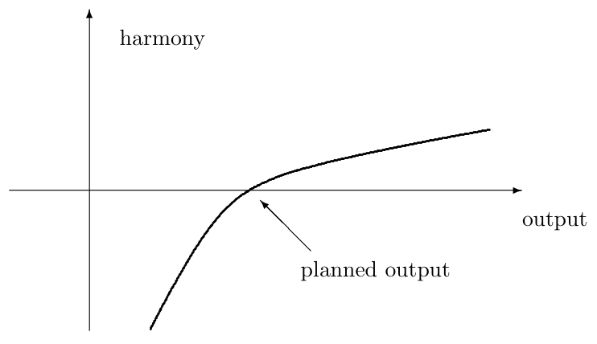

[← Chapter 5: Strategic Planning](05_Strategic_Planning.md) · [↑ Contents](README.md) · [Chapter 7: Macroeconomic Planning and Budgetary Policy →](07_Macroeconomic_Planning_and_Budgetary_Policy.md)

---

# Chapter 6. Detailed Planning

In chapter 4 we introduced the idea of planning as a case of feedback control. Figure 6.1 recapitulates the basic idea. This general concept can now be extended to take into account the specific points we have made about socialist planning up to this point.

Figure 6.1: Control mechanism

As we have seen, strategic planning deals with the general shape of the industrial structure of the economy. In this chapter we are concerned with detail planning, which deals with just how much of each individual product must be produced to meet these general objectives. The strategic plan may stipulate that 7 percent of national income will be allocated to electronic consumer goods. The detail plan will have to say what this means in terms of quantities of TVs of each model, numbers of each type of amplifier etc. And in order to achieve these output targets the plan must specify the numbers of each type of component required to build the amplifiers and TVs: 500,000 colour mask tubes of 14" diagonal, 300,000 of 20" diagonal, 12.5 million of 10 micro-farad ceramic capacitors, and so on.

Figure 6.2 displays the inputs into detail planning. Simulation and scheduling involves constructing a detailed model of the operation of the economy in order to predict how much of each intermediate input will be required to produce the final combination of outputs. Marketing — which feeds into detail planning indirectly—returns information on whether the price people are willing to pay for a product is high enough to justify its continued inclusion in the plan. If people are not willing to pay as much in terms of labour time as the labour time required to produce it, then that particular product should be cut back or discontinued and resources shifted to a different one. The details of our proposed marketing feedback mechanism will be set out separately in chapter 8; for the moment we will concentrate on simulation and allocation.

Figure 6.2: Structure of planning

We introduced input–output tables in chapter 3, in the context of calculating the total labour content of commodities. This method of representing the economy is also very useful for formulating and understanding the problem of detailed planning. An example input–output table is shown in Table 6.1. The reader may also wish to refer back to the example shown in Table 3.2. Recall that the input–output table or matrix records the flows of product from each industry to every other industry. Each industry appears twice, occupying one row and the corresponding column. In the presentation we employ here, along a given industry’s row there appear the quantities of that industry’s product that are supplied as inputs to all industries. For instance, if row 1 refers to the oil industry, the numbers in that row represent the quantities of oil supplied to the oil industry itself, to the electricity-generating industry, to the truck-manufacturing industry, and so on. Down each industry’s column we find the quantities of all products that are required as direct inputs to the given industry. For instance, if column 3 represents the truck-manufacturing, then reading down that column we will find the quantities of oil, electricity, and so on required to make trucks.

Table 6.1: portion of an input–output table

|   |   |   |   |   |
|---|---|---|---|---|
|  | oil | electricity | trucks | etc. |
| oil | 1,000 | 50,000 | 800 | . . . |
| electricity | 50 | 20 | 40 | . . . |
| trucks | 30 | 10 | 20 | . . . |
| etc. | ... | ... | ... | ... |

- Rows show where the ouput of each industry goes.

- Columns show the inputs required by each industry.

- Figures in the table should be thought of as in appropriate physical units (e.g. barrels of oil, kilowatt-hours, and numbers of trucks worn out, all on an annual basis).

Some basic terminology is useful for understanding what is going on here. First of all, the gross output of an industry refers to the total output of that industry, regardless of the use to which it is put. Gross output is sub-divided into intermediate output and final or net output. Intermediate output is that portion of the industry’s product which is destined to be ‘used up’ within the productive system itself (for instance, the coal used in the steel industry, or the steel used in the personal computer industry). Final or net output is the remaining portion of the product, available for final uses (either consumption, individual or collective, or net investment designed to build up the economy’s productive base).

Some products are more or less pure intermediate goods. For example, aside perhaps from a few metal-working hobbyists, consumers simply have no interest in sheet steel, so that virtually the entire output of sheet steel will figure as intermediate product, entering the production process in various industries. On the other hand, some goods are pure final goods, with no intermediate uses (no industry uses packs of cigarettes as an input). But some goods have both intermediate and final uses. Natural gas is used by households for cooking and heating, as well as by various industries as an input to production.

One more term is important: the technical coefficient for an ordered pair of industries tells us how much of the one industry’s product is needed (directly) in order to produce one unit of output of the other industry. For instance, if it takes 10 kilograms of steel tubing to make one bicycle, then the (steel tubing, bicycles) technical coefficient is 10, if steel is measured in kilos, or .01 if steel is measured in tonnes. Note that the total direct input requirement for steel tubing in the bicycle industry can be found by multiplying the total output of bicycles by the relevant technical coefficient. With a coefficient of .01, the production of 2000 bikes would require 2000 × .01 = 20 tonnes of steel tubing.

We are now ready to address the structure of the problem facing the planners in a socialist economy. What people are ultimately interested in is the bundle of final goods that the economy produces. Suppose we have a set of targets for such goods.[^1] Meeting these targets requires that the appropriate amounts of intermediate goods are produced. The PC industry can turn out the number and type of PCs that are wanted only if it receives the right amounts of plastic, steel, silicon, etc. from its industrial suppliers, which in turn requires that those other industries receive the intermediate products they need, and so on, in a highly complex web of interdependence.

So here is the problem: Starting from a list of desired final outputs, how can we compute the gross amounts of every kind of product that are needed to support the final output targets? In principle, the answer can be found directly, as follows. (Those who find mathematical notation excessively daunting might skip a few paragraphs to the conclusion, but we use only the simplest of algebra.) Consider a simple little system with only two distinct industries. Let *G* denote gross output, *I* intermediate output, and *F* final output. Subscripts denote the industries, 1 and 2. Since gross output equals intermediate output plus final output, we can represent our toy economy with the following two equations, one for each industry.

*G*1 = *I*11 + *I*12 + *F*1 
*G*2 = *I*21 + *I*22 + *F*2

In the double subscripts against the intermediate outputs (*I*), the first number represents the source of the product and the second represents its destination, so that *I*12, for instance, denotes the amount of industry 1’s product used in industry 2. Spelled out in English, the first equation says that the gross output of the first industry is the sum of three components: first, the intermediate output of product number 1 required within the first industry itself (as, for instance, the oil industry consumes some oil; for any industry which does not consume any of its own product this term will be zero); second, the intermediate output of product number 1 needed in industry 2; and third, the final or net output of product number 1.

Now perform this simple trick: write each intermediate output quantity (*I*) as gross output (*G*) times the relevant technical coefficient. This is just as in the case of the bicycles and the steel tubing discussed above, where the intermediate use of steel tubing in the cycle industry was equal to the gross output of bikes times the steel-tubing-per-bike requirement. If the technical coefficients are denoted by *a*’s, we will have the following:

*G*1 = *a*11*G*1 + *a*12*G*2 + *F*1 
*G*2 = *a*21*G*1 + *a*22*G*2 + *F*2

Without going through all the steps, we can now see how the problem may be solved. After replacing the *I*’s with the *a*-times-*G* terms, we have reduced the problem to a matter of two equations in two unknowns, namely the gross outputs of the industries. Simple but tedious algebra should yield the desired result: equations specifying the gross output of each industry as a function of the final outputs and the technical coefficients alone. And once the gross outputs are found, the intermediate outputs flowing into each industry are easily found too—again, as in the bicycle example.[^2]

The mathematics of the problem have been well-understood since the pioneering work of Wassily Leontief and John von Neumann in the 1930s and ’40s, and the solution is not hard to find if the system is reasonably small. But if one is dealing with a whole economy, the only way to make the system ‘small’ is to express it in highly aggregated terms. The rows and columns of our spreadsheet might refer to, say, ‘consumer electronics’, ‘motor vehicles’, ‘oil and gas’, and so on. This is acceptable for some purposes, but it is not good enough for practical socialist planning. If the planners are to provide a blueprint which can effectively guide production, ensuring that that all economic activities mesh properly, they must be able to specify the outputs and inputs in exact detail. But in that case the input–output table will be colossal, with millions of rows and columns and therefore thousands of billions of technical coefficients. Solving the resulting system of simultaneous equations is not a trivial task. In addition a prodigious amount of detailed information must be gathered (e.g. in the form of the technical coefficients) before calculation can even begin.

Information gathering, and the mathematical processing of that information: both of these issues are important. We will begin by examining the task of calculation, assuming the necessary data to be ‘given’ (the economists’ favourite little phrase); in chapter 9 we shall return to the problem of obtaining the data.

The mathematical issues which arise here are essentially the same as for the computation of labour values, discussed in chapter 3. In principle, the problem could be solved directly via Gaussian elimination, but, as we saw in chapter 3, this is simply not feasible for extremely large systems. As with labour-value computation, the way to proceed is to exploit the sparse nature of the input– output matrix or ‘spreadsheet’. Since the table, when specified in full detail, has a huge number of zero entries (representing the toothpaste that is not used in making sausages, the timber that is not used in making spectacles, and so on), we can better represent the conditions of production in the form of linked lists, and then seek an iterative solution.

The two main iterative techniques available (known as the Jacobi and Gauss-Seidel methods) will accept input data in the linked-list form. These methods do not directly calculate the answer to the problem, but they produce successively closer approximations to the answer. For the economic input–output application it can be shown that if there is a unique solution to the problem—which could in principle be calculated directly—then these iterative methods will produce results which converge on that solution (Varga, 1962).

The working of the iterative method in this application can be explained fairly simply. The required data input comprises (i) the target final output list, (ii) the (non-zero) technical coefficients and (iii) some initial guess at the required gross output of each product. These starting values for gross output are then fed through the set of technical coefficients, and the quantities of each product needed as inputs are calculated. On this basis, a new set of gross output figures is calculated. This new set is then used as the input for another round, and so on. If the algorithm is convergent (i.e. if the problem has a unique solution in the first place), then after a while the change in the gross output numbers from round to round will get smaller and smaller. The algorithm terminates once all the approximate gross outputs change by less than some pre-set ‘small’ amount.

The choice of starting values for the gross outputs is not crucial, as the convergence property of the algorithm is independent of initial conditions: if some starting values will work, then so will all starting values (again, see Varga, 1962). Nonetheless, convergence on the solution will be quicker if the initial guesses are reasonably close to the correct values. The planners can rely on past experience, where applicable, to select starting values of the right order of magnitude.

The time order of the Jacobi iterative method is given by the number of outputs times the average number of distinct direct inputs needed in each production process, times the number of iterations required to produce a satisfactory approximation. If there are, say, 10 million products with an average of 200 direct inputs each, and 100 iterations are needed, then 2×1011 calculations must be performed. Suppose each of these requires 10 computer instructions. In that case we have a total of 2 × 1012 instructions, and a computer with a speed of one billion instructions per second could do the job in 2 × 103 seconds, or a little over half an hour.

## Planning in the USSR

Two sorts of questions suggest themselves at this point, concerning the relationship between the argument we have just been through and the experience of planning in the Soviet Union. First, one might ask: If the calculations required for consistent detailed planning are so vast and complex, how on earth did the Soviets manage before high-speed computers were available?

In fact it is rather remarkable that the Soviets should have been so successful, during the pre-computer days of the 1930s, in building up their heavy industrial base using centralised planning methods. The economy was, of course, much less technologically complex at that time, and the plans specified relatively few key targets. And even so, there are many tales of gross mismatches between supply and demand during the period of the early 5-year plans. A huge expansion of the inputs of labour and materials meant that the key targets could be met despite such imbalances.

In addition, we should note that the early Soviet plans were not drawn up in the way we have described. Working backwards from a target list of final outputs to the required list of gross outputs, consistently and in detail, was quite beyond the capacity of Gosplan, the state planning agency. Often, instead, the planners started out from targets that were themselves set in gross terms: so many tons of steel by 1930, so many tons of coal by 1935, and so on. This early experience arguably had a deleterious effect on the economic mechanism in later years. It gave rise to a sort of ‘productionism’, in which the generation of bumper outputs of key intermediate industrial products came to be seen as an end in itself. In fact, from an input–output point of view, one really wants to economise on intermediate goods so far as possible. The aim should be to produce the minimum amounts of coal, steel, cement, etc., consistent with the desired volume of final outputs.

The second sort of question that arises here is in a sense the reverse of the first: If the mathematical and computational techniques we have discussed are well known, how come the Soviet planners weren’t doing much better by the mid-1980s, when fast computers had become available?

We have pointed out part of the answer to this, in discussing the first question above. The necessarily rather crude planning methods of the 1930s left their mark on the system that evolved in later years. Given the peculiar ideological sclerosis of the late Stalin years—interrupted by the Khrushchev ‘thaw’ but then resumed under Brezhnev—new approaches to planning were generally regarded with suspicion. There is a suggestion in the literature on Soviet economics that the very idea of starting the planning process from final output targets (the procedure we have advocated above) was seen by the official guardians of orthodoxy as somehow ‘bourgeois’.

In addition, interest in novel computer-based planning methods in the USSR came ‘out of phase’ with the real technological possibilities. The types of computer system available to Soviet planners in the 1960s and even the ’70s (when the improvement of the planning system was a live issue) were primitive by today’s Western standards. Soviet economists were well aware of the potential benefits of the use of consistent input–output techniques, but the equipment at their disposal permitted the analysis of only ‘small’, highly aggregated input– output systems. While these were of some use for inter-regional planning exercises (investigating the interdependence of the regions of the USSR), they could not be used for routine detailed planning. For the most part, input–output analysis remained an academic exercise, and the overall impact of the computer on Soviet planning disappointed the early expectations.[^3]

It is important to note that the unavailability of super-fast central computers was not the only or even the most important constraint. As we explained in chapter 3, in the context of calculating labour values, it would be possible to accomplish the same results using a large distributed network of much more modest personal computers, linked by an economy-wide telecommunications system. Such equipment was also unavailable in the years when Soviet economists were thinking seriously about improving the planning system. Cheap PCs are a relatively recent development, and besides the telecommunications system in the USSR is notoriously backward (as anyone who has tried to make a phone call between Moscow and Leningrad knows).

Further, as we shall see in chapter 9, effective detailed planning requires a standardised system of product identification, which in turn demands sophisticated computer databases. In the USSR, the planners continued to work with the system of so-called ‘material balances’. This system, which involved drawing up ‘balance sheets’ showing the sources of production and the planned uses for each product individually, represents a sort of crude approximation to the input–output method. Not only were the planners unable to calculate effectively the interactions amongst these balances, but in addition the classification of products was incomplete and inconsistent.

A political point is also relevant here. Our planning proposals absolutely require a free flow of information and universal access to computer systems, and this was politically impossible in the USSR under Brezhnev. Even access to photocopying equipment was strictly controlled for fear of the dissemination of political dissent.

Finally, of course, computerisation is no panacea. There were many problems with the economic planning mechanism in the USSR which would have had to be tackled before the application of extra computer-power could be expected to yield much of a dividend. (One example: the irrational and semi-fossilised pricing system, with the prices of many goods stuck at levels which guarantee shortages and queues.)

Effective detailed planning of a complex economy, it would appear, requires the sorts of computer and telecommunication technology available in the West as of, say, the mid-1980s. By this time, however, the ideological climate in the Soviet Union had shifted substantially in favour of market-oriented ‘reforms’. It would seem that Soviet economists—or at any rate, those who had the ear of the political leadership under Gorbachev—were little interested in developing the sorts of algorithms and computer systems that we have discussed. They had apparently lost their belief in the potential of efficient planning, perhaps partly in response to an earlier, premature overselling of the benefits of computerisation, and partly in response to the trend in favour of free market economics in the West.

## Detail planning and stock constraints

To return to the main line of our argument, we have claimed that it is now quite feasible for a planning agency to work backwards from a list of final target outputs to the list of gross outputs which will balance the plan, even when the input–output table accounts for the relations between industries in minute detail. But this does not complete the calculations necessary for the detailed plan. It may not be possible to produce the quantities of all products that are called for by the gross output computations, because of ‘external’ constraints in the form of stocks of means of production and labour supply.

The planners may calculate that satisfaction of the plan targets calls for the generation of *x* tera-kilowatt-hours of electricity. The balancing of the input– output system will have ensured that sufficient oil, coal, or uranium is called for to meet that electricity requirement, but is there enough generating capacity in the form of power stations? The economy’s ability to produce over any given period is limited by the availability of stocks of durable capital goods which take a long time to build. And then there is labour: is there enough labour available to meet the gross output requirements of the plan?

These questions can be answered fairly quickly once the gross output numbers are generated. The planning system can forward to each industry its gross output requirement, and the individual industry computers (which need not be super-fast machines) can then calculate their needs for means of production stocks and labour, exploiting their knowledge of the per-unit means of production and labour coefficients for their own sector. These industrial needs can then be fed back to the central computers, summed up, and compared to the central records of the stocks of means of production of different types, and to the central calculation of labour supply respectively.

If the constraints happen to be met—i.e. if the industries are calling for no more of each type of means of production, and for no more labour, than is available economy-wide—well and good. Note, though, that even if the overall constraints are met there may still be a need for a reallocation of resources between industries: the central planning agency would have to optimise this reshuffling and issue instructions accordingly. But if the overall constraints are violated at this point, some adjustment of the plan is needed. The original target final output cannot be achieved (unless the ‘external’ constraints can somehow be relaxed), and the planners must think again. Those final output targets which have the lowest social priority can be reduced, and the whole calculation repeated. Since the complete process is likely to take hours, or at worst days, a number of repetitions are possible within a reasonable time-frame for plan construction.

The importance of this last point—that is, the presence of constraints on production other than those taken into account by the system of input–output flows—really depends on the time-frame of the planning decision. If the plan is sufficiently long term, then stock constraints become less relevant. If more electricity-generating capacity is called for, then it can be built up accordingly. In the limit, the only ‘external’ constraints on the economy’s input–output system are the supply of labour and the availability of non-reproducible natural resources. In that case, adjusting the target levels of final output in conformity with the external constraints should be relatively simple. But conversely, the shorter the time-scale of the plan, the more important the ‘external’ stock constraints become. Any means of production that take longer than the plan period to construct must be reckoned as stock constraints; and if the time-scale is very short, the state of inventories of materials becomes important too. One of the authors has been investigating a computer algorithm suitable for plan-balancing in the latter situation, an algorithm which differs substantially from the standard input–output approach outlined above. The theoretical basis for this alternative algorithm is presented in the next section, along with a worked example of its application.

## A new plan-balancing algorithm

Suppose we start off with a shopping list of annual outputs that we want to achieve for 100,000 different consumer goods. These targets may be conservative, in which case resources would be left idle, or they may be excessive and beyond what could be achieved with current resources. We would like to know whether the targets should be scaled up or down to make efficient use of resources, including the economy’s existing stocks of machinery of various kinds. It is unlikely to be a matter of making an *x* percent change in the quotas for all consumer goods. Quotas for some goods will have to be adjusted up or down more than others.

If we have a limited number of sheep and spare capacity in the chemicals industry, we want to know what this implies for quotas of wool and acrylic jumpers. Should targets for wool garments be cut? And what does this imply for production of acrylic ones? How many knitting frames should be switched from producing wool to acrylic?

Suppose the free knitting machines could be allocated to any one of a thousand lines of knitwear. All the spare capacity could be poured into increasing production of a particular line of fluorescent blue jerseys with ‘St Tropez Sport’ written across the front in pink, but it is doubtful if such a solution would please consumers. What is required is a set of rules by which computers can decide what are likely to be sensible adjustments to the plan targets in the light of resource constraints. We have developed a computer program which will make such adjustments based upon the economic principle of diminishing marginal utility. A full account of the algorithm can be found in Cockshott (1990).

### The harmony function

The algorithm uses techniques developed for neural net simulations (a sub-field within Artificial Intelligence). Researchers in this area have proposed that neural systems can be analysed using thermodynamic concepts. A nervous system consists of a large population of entities loosely coupled to one another, and as such it falls into the abstract category of problems treated by statistical mechanics. It has been found that thermodynamic concepts like energy, entropy and relaxation can be usefully applied to neural models. Each neurone, like an atom in a solid, is linked to and reacts with a subset of the total population. In both cases we have large populations developing under stochastic laws[^4] subject to local interactions. One can define a suitable analogue of energy for a neural net—broadly how closely its behavior corresponds to the desired behavior. It can be shown that if one introduces into the behavior of the neural net a computational analogue of temperature, then by a relaxation process one can cause the net to stabilise around the desired behavior pattern.

Again arguing by a process of analogy, neural nets and crystals are, at a certain level of abstraction, rather like an economy. In an economy industries are linked to one another by local interactions. In this case it is the relationship of supplier to user rather than synaptic connections or electrostatic forces that we are dealing with, but there is an abstract similarity.

Note the similarity between the neural net in Figure 6.3 and an input–output matrix. The columns in the diagram represent the outputs of the nerve cells on the right. The synapses drive the inputs to the cells which are represented by rows. The rows act to sum the level of excitation on their inputs. The level of excitation on the inputs in turn determines the level of output on the axons. We can make an analogy with the columns of an input–output table representing the levels of activity of an industry. Let us label the synapses *Sij*, where *i* ranges over the rows and *j* ranges over the columns. The strength of the connection on *Sij* represents the amount of output of the *i*th industry used to produce one unit of the *j*th industry. Neural net theory predicts that such a net will settle into a pattern of excitation that is consonant with the weights on the synapses. The resulting levels of excitation on the cells would represent the relative intensities with which the industries should be operated. Neural nets can be modeled mathematically. The implication is that we should be able to balance an economy by the same sort of mathematical techniques of relaxation as are used in modeling neural nets. What we have to do is find some analogue of energy which we can minimise.

Figure 6.3: Stylised neural net

People working with neural nets often pose the problem in the inverse sense— instead of trying to minimise the energy of the network they maximise what they call its harmony. Formally this is just the inverse of energy, but it has a greater intuitive appeal. A neural net is set to be in a state of maximal harmony when it has learned to give the ‘right’ responses to external stimuli.

We can apply this notion of harmony to an economy. We define a harmony function over each industry of the form shown in Figure 6.4.

As can be seen the harmony becomes rapidly negative if the net output (output after allowing for consumption of the product by other industries) of a product falls below the target. The harmony gradually becomes positive if we exceed the target. This is to indicate that the problems caused by shortages are more serious than the benefits obtained from surpluses. An illustrative function with these properties is shown in algorithmic form below:

Figure 6.4: Harmony function

Let *u* = (output − goal)/goal. 
If *u* < 0 then harmony = −*u*2, 
otherwise harmony = √*u*.

The idea is that people get diminishing satisfaction from each additional unit of a particular good they consume. The first time your relatives give you a teapot for Christmas your gratitude is heartfelt; the fifth time round it is a little forced. The implication of this is that the additional social satisfaction that comes from exceeding output targets tends to fall off rather sharply, and people will be more upset about shortages than they will be pleased by superfluity. We can model this with what we term a harmony function as shown above.

When output of a good is at target level we define the harmony for that good to be zero. If output is in excess of the target the harmony is positive and when output is below target harmony is negative. This harmony function is used by the computer as a guide to adjusting outputs. Our objective is to maximise the harmony of the entire economy, to bring it all into balance.

### Stages of the algorithm

- (1) Randomly allocate resources to the industries. This is a notional random allocation, taking place within the computer. No real allocation of goods in the economy takes place at this stage. We specify a random allocation, since if our relaxation technique is valid then any starting point is as good as any other.
- (2) For each industry determine which of the resources currently available to it is the rate-limiting factor, that is to say the resource that acts as a bottleneck on production.
- (3) Each industry gives up non-critical resources (i.e. those which are surplus to requirements, given the rate-limiting factor) and allocates them to a common pool. This by definition does not reduce production and thus leaves harmony unaltered. Note that this reallocation takes place only within the computer’s memory; there would be no reallocation in the real world until the whole algorithm terminated.
- (4) Work out harmony of each industry.
- (5) Work out the mean harmony for the whole economy.
- (6) Sort industries in order of harmony.
- (7) Starting with those industries with highest harmony, reduce their output until their production level is such that their harmony is equal to the mean harmony. This is easy to do since the harmony function is invertible (that is, we can work backwards from harmony level to the corresponding output just as easily as from output to the corresponding harmony). Resources thus released go into the common pool.
- (8) Starting with the industries with lowest harmony, assign to them resources from the ‘pool’ and increase their output until they are producing at a level equal to the mean harmony.
- (9) Work out the new mean harmony. If it is significantly different from before go back to stage 6.

This algorithm has the effect of equalising the harmony of the different industries. After as few as a dozen iterations mean harmony will change by less than 1 percent with successive iterations. By itself, however, it has the drawback that it only brings the economy to a local maximum of harmony. In computer experimentation, one often finds with the algorithm in this form that there are unused resources left over and that the overall level of output is lower than it could be. Intuitively we can understand this as being due to the very strong tendency of the algorithm to settle in the region of whatever mean harmony it starts out with.

This can be overcome by introducing a bias towards increased output. In step (7), instead of reducing output of high harmony industries to the mean, we adjust their output until it is equal to (mean + *B*) where *B* is the bias. At the start of the program we set *B* high then reduce it with each iteration. The effect of this is that only industries with very high initial harmonies reduce their output at first, but the industries with low harmonies continue to increase their outputs. In consequence the mean harmony tends to rise with each successive iteration, and the system eventually stabilises around a maximal mean harmony.

Provided one chooses one’s data structures carefully this algorithm is approximately linear in running time. In other words, a problem with 100 industries will take 10 times as long as one with 10 industries. As with the conventional input–output analysis discussed above, one important point is not to represent the input–output table as an array, but to take advantage of the fact that it is a very sparse matrix and represent it using linked lists. The time order of the algorithm will then be roughly nm where n is the number of industries and m the mean number of inputs per industry. The algorithm is reasonably simple, and has been used to simulate a plan for about 4000 industries on a Sun workstation in about 300 seconds. A Sun workstation executes about 3 million instructions per second. Since it is linear in its time requirement the program should take something like a million seconds (less than 2 weeks) on a 68020 (a popular microprocessor) to balance the plan for an economy with 10 million products. It would also require something like a thousand megabytes of store. This requirement is not excessive; it is equivalent to a thousand PCs and would cost about half a million pounds at current prices.

A British company Meiko has developed a multiprocessor that uses up to 1024 micro processor chips to gain speed. The proposed use of this machine is in particle physics simulations, and it is capable of 10,000,000,000 instructions per second. If we could run the problem on a Meiko computing surface with 1024 transputer chips, each with 4 megabytes of memory, the plan for a major economy would be computable in about 10 minutes.

In addition to arriving at a feasible set of target outputs, the algorithm would also produce as a side effect the correct allocation of capital goods and raw materials between industries. This is exactly the detailed information that one needs for a plan.

We have argued that there exist computational techniques that would allow the detailed planning of an economy in terms of physical units without any reference to money or prices. These techniques are computationally tractable, and could be accomplished on the sorts of high performance computers that are currently available for things like particle physics and weather forecasting. They can be viewed as simulating beforehand the sort of equilibration process that an idealised market is supposed to achieve.

## Economic cybernetics in Chile

One of the most interesting experiments with computerised planning and control of the economy was undertaken in Chile under the Allende government in the years 1972 to 1973. The system was designed by Stafford Beer and is described in his book *The Brain of the Firm*.[^5] Beer’s objective was to provide real time decentralised control of the economy. Since his system provides a practical example of the general type of regulation mechanism we are proposing, it may be useful to outline its characteristics.

With the conventional statistical methods available to Western governments, economic statistics are often many months out of date by the time they arrive on the desks of decision makers. In consequence, decisions may be made to try to resolve a crisis some months after the crisis actually occurred. Since the policy instruments available to the government are also slow-acting, decisions may be taken whose effects are the opposite of what was intended. After the stock market crash of 1987, the British government feared a recession and in 1988 introduced tax cuts. By the time these came into effect demand was already accelerating anyway, so by 1989 the result was accelerating inflation. Lags in the availability of data meant that completely inappropriate action was taken (although in this case there was also a strong ideological commitment to tax cuts, regardless of the macroeconomic conditions).

Such perverse effects, in which feedback induces worse oscillations in the system, can be avoided if controllers are provided with up-to-date information and have the means to take immediate appropriate action. In Chile a computer network was established to do this in only four months, to the great surprise of sceptics who had argued that such a network would take years to set up. The task was accomplished with the computer technology of the early ’70s and the very limited telecommunications capacity of a poor country like Chile. A combination of microwave and telex links joined all the key industrial centers to computers in the capital. Within these limits it was possible to provide the government with economic information that was no more than a day old. More modern equipment could do better.

Information was presented in iconic form. Large screens in an ‘Opsroom’ displayed annotated flow graphs of the interactions between subsections of the economy. The graphics displays avoided using figures. The magnitudes of the flows between different sectors were indicated by the widths of the lines flowing between them. Industries and sectors were shown as blocks with bar graphs inside them telling what proportion of the industry’s capacity was being used. The room provided seating for seven people, this being the largest number who can effectively participate in a discussion. Large buttons on the arms of the chairs could be used to control the displays, and highlight different features.

The notion of the Opsroom was taken from wartime experience in air defence. As in war, real-time information was displayed for immediate decisions. Decisions could be tested using computer simulations which showed what the effects would be if a given course of action were taken. In the event it was used like a wartime headquarters in the struggle to break the anti-government boycotts imposed by private lorry companies. The computer network enabled the government to mobilise all its available transport resources to keep goods flowing.

It was intended that an Opsroom would be provided in each industry, and indeed in each plant. Sophisticated statistical programs analyzed the data flowing up from lower levels of the system to search for any significant changes. Human decision makers were insulated from information overload, and just presented with significant data on which decisions were needed. The Opsroom for a plant would be provided with warnings as soon as anything unusual occurred. If the computers detected a crisis, they alerted the Opsroom and started a clock running. If the Opsroom had not responded effectively within a certain time period, the next higher Opsroom in the tree was alerted. This gave each unit the freedom to act locally within its competence without endangering the viability of the social organism. It was envisaged that the Opsroom at factory level would be run by local workers committees. The democratic presumption was that modern visual and computing aids would allow people to manage their factories without sophisticated training.

With the bloody coup that established Pinochet in power, and prepared the way for Friedmanite monetarist economic experimentation in Chile, all this was swept away. The Opsroom perished with Allende and democracy in the burnt out ruins of the presidential palace.

[^1]: Where these targets are to come from is another matter. We have made some relevant points already, in chapter 5, and will have more to say in chapters 8 and 13 in particular.

[^2]: With many equations, it is more economical to represent these equations in matrix form. The matrix counterpart of the equations in the text, in their second form, is *g = Ag + f* where *g* denotes the (*n* × 1) vector of gross outputs, *f* denotes the (*n* × 1) vector of final outputs, and *A* denotes the (*n × n*) matrix of technical coefficients (*n* being the number of industries in the system). This system can be solved thus: *g = Ag + f ⇒ (I − A)g = f ⇒ g = (I − A)−1f* (In this context, *I* represents the *n × n* identity matrix.) In words, the conclusion says that we can determine the answer, the list of required gross outputs, by finding the inverse of the Leontief matrix (*I − A*) and multiplying this into the final output vector, *f*.

[^3]: For an assessment of the Soviet experience with computers in planning through the 1970s see Martin Cave (1980) and for more detail on our view see Cottrell and Cockshott (1993b).

[^4]: Stochastic laws means subject to the laws of chance, unpredictable in detail but with predictable average behaviour.

[^5]: See also the Afterword to Beer (1975).

---

[← Chapter 5: Strategic Planning](05_Strategic_Planning.md) · [↑ Contents](README.md) · [Chapter 7: Macroeconomic Planning and Budgetary Policy →](07_Macroeconomic_Planning_and_Budgetary_Policy.md)
