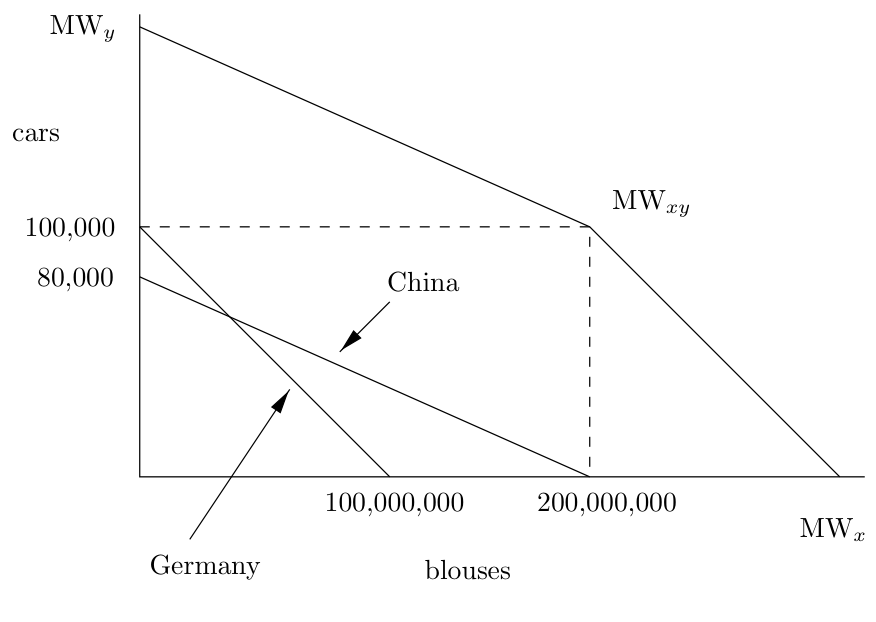
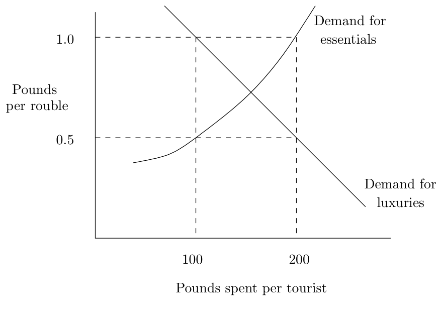

[← Chapter 9: Planning and Information](09_Planning_and_Information.md) · [↑ Contents](README.md) · [Chapter 11: Trade Between Socialist Countries →](11_Trade_Between_Socialist_Countries.md)

---

# Chapter 10. Foreign Trade

> Two men can both make shoes and hats, and one is superior to the other in both employments; but in making hats he can only exceed his competitor by one-fifth or 20 percent., and in making shoes he can excel him by one-third or 33 percent.;—will it not be for the interest of both, that the superior man should employ himself exclusively in making shoes, and the inferior man in making hats? (Ricardo, *Principles of Political Economy and Taxation*, p. 136.)

The socialist movement lacks a definite theory of foreign trade. Marx intended to write a volume of *Capital* on international trade, but he died before starting the task. On most questions to do with how to run a socialist economy, specific prescriptions from Marx are hard to come by, but at least he provides conceptual tools from his analysis of capitalism that can be re-applied to the new subject matter of the socialist economy. With international trade we do not even have this.

Marxian economic theory was generally derived from the theories of Ricardo, and in the absence of any specific Marxian theory of trade, the obvious starting point must be Ricardo. Ricardo proposed the idea that trade between nations arose from the differing comparative advantages that nations enjoyed in the production of commodities. It is important to understand what is meant here by comparative advantage. At first sight it seems that an advanced nation with highly productive industries stands to gain little through trade with less developed countries.

The German clothing industry can probably produce garments with less labour than the Chinese clothes industry. The German car industry can certainly produce cars with less labour than would be needed if they were made by backstreet workshops in Shanghai. In both cases Germany has a productivity advantage over China, but it is nonetheless economical to export Mercedes to China and to import cotton goods to Germany. This arises because of the greater relative productivity of the German car industry. Compared with hand assembly, the highly automated car factories of Mercedes may give, say, a fivefold improvement in productivity; with the rag trade the scope for improvements in productivity is not so dramatic. Although a German clothing firm might be more efficient, the advantage would not be so great as for the car industry. It thus pays Germany to concentrate its labour force in those engineering industries where it has the greatest advantage.

Suppose that a Merc can be made with 1000 hours of labour in Germany and that a woman’s blouse can be made with 1 hour. In China let us suppose that a similar car would take 5000 hours to build and that a blouse could be produced in 2 hours. Based on the simple labour theory of value, the relative exchange values of Mercs to blouses in Germany would be

1 Merc = 1000 blouses,

while in China the relative values would be

1 Chinese luxury car = 2500 blouses.

Given free trade, a capitalist who buys Mercedes in Germany, ships them to China, and brings back blouses will make a substantial profit. He will be able to undercut the more efficient German garment producers. The formation of a world market tends to equalise the relative prices of exportable commodities: the import of Chinese garments will tend to depress the price of clothes relative cars on the German home market, and cheapen the price of luxury cars on the Chinese market. The specialisation associated with trade means that the total world production of both garments and luxury cars can be increased.

Figure 10.1: International production possibilities

Suppose that the Germans have 100 million hours of labour that they can use either on car production or on the production of blouses, and that the Chinese have 400 million hours. Figure 10.1 shows that without engaging in trade with China, Germany can either have 100,000 cars or 100,000,000 blouses or any combination of these two constrained by the formula:

total labour = (cars × German labour per car) + (blouses × German labour per blouse)

China on the other hand can independently choose any combination of blouses and cars constrained by the formula:

total labour = (cars × Chinese labour per car) + (blouses × Chinese labour per blouse)

The world as a whole (if these are the only two countries) is constrained by both these relations: world car production = German + Chinese car production, and world blouse production = German + Chinese blouse production.

As a result of these constraints we have:

- (1) Maximum world production of cars (MW*y*) = Chinese + German maximum production = 180,000.
- (2) Maximum world production of blouses (MW*x*) = Chinese + German maximum production = 300,000,000.

Consider the point MW*xy* which represents production of 200,000,000 blouses plus 100,000 cars. This is the combined world production which occurs when Germany produces nothing but cars and China nothing but blouses. It can be shown that there is no way in which so many blouses and cars can be produced if each country produces some of both goods. From a starting point with both countries completely specialised, let Germany decide to produce 90,000 cars and 10,000,000 blouses, and let China decide to produce 10,000 cars and 175,000,000 blouses. Total world production of cars will be unchanged at 100,000 but world production of blouses will fall from 200,000,000 to 185,000,000. Any such move away from complete specialisation diminishes production of at least one of the goods. This is the essence of Ricardo’s argument in his parable about the shoemaker and the hatter. It is a particular example of the class of problems that can be solved by the mathematical technique of linear programming.

International trade allows an increase in total world production as a result of specialisation. This additional production constitutes a source of profit that does not depend upon the direct exploitation of workers. Mercantile capital was able to tap this source of profit in the ancient and medieval worlds when direct production was under the control of classes of agrarian slaveholders or landowners. The ability of the trader to appropriate a share of the surplus was the foundation of the wealth of trading states like Rhodes and Venice.

The labour theory of value developed by Smith, Ricardo and Marx assumes that the equilibrium prices of goods within a country will be in proportion to their labour content.[^1] What can it predict about world prices? Let us consider first the situation where the two countries have not yet fully specialised. In this case the limits to the relative prices of the two goods will be set by their national labour values. In the previous example the price of cars expressed in blouses will be somewhere between 1000 blouses (as in Germany) and 2500 blouses (as in China). It should not fall below 1000 or rise above 2500. Because both goods will be produced in each country, the less economical domestic product will be competing with a cheaper import, so the relative price of cars falls in China and the relative price of blouses falls in Germany. The existence of two different price ratios is what gives rise to the international traders’ profits.

It is unlikely that both countries will specialise totally and fix output at the point MW*xy* in Figure 10.1. It would be quite fortuitous should this output ratio for the two goods correspond to the ratio in which they are demanded. It follows that the equilibrium condition is likely to be one in which one country specialises totally, but the other continues to produce both goods. Under these circumstances the labour value theory predicts that the exchange ratios of the goods in both national markets will be determined by the ratio of their labour values in the country that is not fully specialised. Hence if aggregate demand for cars was greater than 100,000 whilst aggregate demand for blouses was less than two hundred million, Germany would specialise completely in car production and China would produce some cars and some blouses. In this case the Chinese domestic price ratio would determine the world price ratio. German car producers would then earn excess profits through being able to sell their cars at the higher Chinese price.

In the Ricardian theory an essential role in the maintenance of balanced trade between nations was played by monetary movements. Suppose that Germany ran a trade deficit with China. In order to pay for imports German merchants would have to make payments to their Chinese suppliers in Chinese currency. This currency could be obtained by exporting German goods, but if these were not being exported in sufficient quantity, Chinese currency would have to be purchased with gold or silver bullion. In meeting imports, a portion of Germany’s stock of gold and silver coin would have to be exported. This would cause a shortage of currency on the domestic market and lead to lower prices. Domestic deflation would make imports relatively dearer and bring trade back into balance.

Suitably generalised, this form of argument is not really limited to international trade—it is applicable to regional trade within a state. If Scotland runs a trade surplus with England, then there will be a net flow of currency north of the border. This will lead to local inflation (higher house prices etc.), but it will also prompt a higher level of consumption which will tend to eliminate the internal trade imbalance. If there is a single set of prices for goods that are nationally traded, then on the same argument as for international trade one would expect regions to concentrate on the production of those commodities for which they have the greatest relative advantage.

The classical theory of foreign trade is a very abstract account, and does not take into account many details of the modern world market. For instance, world monetary systems are no longer based on the gold standard as in Ricardo’s day. Consequently, the elimination of trade imbalances by means of movements in gold or silver cannot operate. Credit money and speculative movements in response to changes in interest rates now allow chronic trade imbalances. When Ricardo was writing, international indebtedness with its systematic distortion of trade flows was unknown. Further, the idea of comparative advantage tells us little unless we have some idea why these comparative advantages arise.

## Technology and trade patterns

Although the Ricardian theory does give us some useful information about causes of trade flows it abstracts from the origins of comparative advantage. Why are some countries better at producing particular goods? A major component of trade flows is obviously explained by climate and the distribution of mineral resources. That Saudi Arabia exports mineral oil and Greece olive oil is explained by the endowments of nature. But we can not explain the Japanese export of silicon chips by the easy availability of sand in Japan.

With the uneven development of technology, only a few advanced countries may have any ability to manufacture certain goods. It does not make much sense to compare the comparative advantages of Indonesia and the USA in producing jumbo jets and leather goods, when the USA has an effective world monopoly in jumbos. The analysis could be forced into a Ricardian framework (by working out how much labour it would cost Indonesia to produce its own jets), but this would obscure the more significant factor of very uneven technological development. The structure of trade among the industrialised countries is largely determined by the areas of their technological expertise. An advanced technology helps a country in two ways:

- (1) It raises the general productivity of labour in a country and thus its overall standard of life.
- (2) It provides specialised products which the country can export to obtain products which it is less able to produce.

Trade deriving from technical advances is unstable. Advantages are temporary, for in time technologies become common knowledge. Leading industrial countries constantly develop new comparative advantages by introducing new branches of production based upon the results of scientific research. To this extent the products they sell represent the embodied value of their scientific and engineering research. The particular products that they export change from year to year, so that vis-a-vis the less industrialised counties what they are ‘specialised’ in is the ability to develop new things.

## Low wage and high wage economies

A topical issue in the developed capitalist countries is the decline of traditional industries in the face of competition with the newly industrialised countries. This industrial decline has hit the working classes of the USA and Western Europe over the last decade or two, causing large scale unemployment. This has led to political demands for protectionism to prevent job losses. Unlike the situation which prevailed prior to the second world war, when the leading industrial powers tried to protect their home markets, bourgeois governments have resisted this pressure and pushed for even greater free trade. They have used the classical argument that free trade will lead to greater production and higher overall living standards than protectionism. It has been left to trade unions and political parties drawing their support from working-class voters to argue for protectionism. They have argued that unemployment in the developed world is a consequence of competition with the low-wage economies of the third world. Although this issue does not relate directly to our subject matter— foreign trade policy in socialist economies—it is indirectly relevant since socialist parties campaigning for power in capitalist countries have to address it.

In its baldest form, the issue is whether free trade between a low-wage and a high-wage economy will undermine the industries of the latter. Intuitively it seems obvious that cheap goods from the low wage country will flood in and cause unemployment, but the Ricardian theory claims that this intuition is false. In order to isolate the effect of low wages, other differences between the countries must be eliminated. We must assume that they have the same labour productivity and that neither has any natural advantages due to mineral reserves and the like. Under these circumstances the relative prices of commodities in the two countries will be the same. If the amount of labour required to produce cars, and the amount of labour required to produce washing machines, is the same in each country, then the relative prices of cars and washing machines will be the same in each national currency. But in that case there is no profit to be made in international trade, and far from imports flooding in to the high-wage country there will be no international trade at all.

An exception to this occurs when a government systematically overvalues its currency, in which case all imports appear cheap and they will flood in causing domestic unemployment. But there is no necessary link between an overvalued currency and wage rates. Countries with either high or low wages may overvalue their currency for short periods. The labour theory of value predicts that the capitalists in the country that pays low wages will enjoy higher profits, but that they will not threaten the workers in the high-wage economy.

One reason that this contrasts with intuition and experience is that high-and low-wage economies often have different technologies. Activities like textile production and heavy engineering are among the first that newly industrialised countries move into. These are therefore the ones in which they have the greatest comparative advantage, and it is this comparative advantage rather than low wages that explains their exports. The low wages paid in the Indian aircraft industry have yet to threaten the jobs of aerospace workers in Seattle.

Another reason why the Ricardian predictions seem unrealistic is that we have focused on free movement of commodities alone. If we take into account capital movements the previous conclusions no longer hold. Now the capitalists in the high-wage economy will move their capital to where it will earn more profit. This movement of capital from the high- to the low-wage economy will cause industrial unemployment in the high wage economy.

Subsequently the capitalists who exported capital will start living off their overseas earnings. The flow of repatriated profits will strengthen the metropolitan country’s currency, enabling it to finance an excess of imports over exports. The combination of an excess of imports with a decline in industrial employment then leads people to think that the former led to the latter. The implication of this argument is that it is much more important for a socialist government to impose controls on the movement of capital than to impose import controls. It is only when capital can flee abroad that the low wages paid in newly industrialised countries threaten the overall living standards of workers in the developed world. Free movement of goods will not by itself affect the internal income structure of countries, although it may cause structural shifts between branches of production.

## Advantages of trade deficits

> Upon the final analysis do you find that you have gained anything by your policy of always selling to foreigners without ever buying from them? Have you gained any money by the process? But you cannot retain it. It has passed through your hands without being of the least use. The more it increases the more does its value diminish while the value of other things increases proportionally. (Mercier de la Rivière, *L’Ordre Naturel et Essentiel des Sociétés Politiques*, 1767)

The classical economists developed the labour theory of value in a struggle to understand the underlying workings of the economy. They wanted to know what was going on in the real economy beneath the ‘veil’ of money. One of their objectives was to produce arguments against the dominant mercantilist theories which justified restrictions on imports as a way of preventing money flowing out of the country. The classical economists argued that this concern with monetary flows was spurious and that it was of no benefit to a country to run a trade surplus. For what did a trade surplus mean but that a country had exchanged useful commodities for gold which was of no use at all? A country that continually runs a trade surplus is giving over to the rest of the world a portion of its annual product for which it gains nothing in return. A trade surplus, far from being desirable, actually impoverishes a country.

This insight has been lost on British Labour governments who seem to have attached some mercantilist virtue to a trade surplus. But in this they were not alone. Across the world, capitalist governments proclaim trade surpluses to be a good thing. Like many good things they can be gained by devout hopes and by sacrifices. The sacrifices in this case come in the form of austerity packages that cut working-class living standards to release resources for exports.

According to the classical economists this is all being done in pursuit of illusory gains, but an illusion so persistent and stubborn is not to be explained by the stupidity of the deluded; it must have its origin in real social pressures.

In the case of debtor nations that pressure is plain. They are driven to seek a trade surplus in order to be able to pay off their debts. Where indebtedness is particularly high, the trade surplus may all go on paying the interest on foreign debts. In these cases the deleterious effects of trade surpluses are strikingly evident: the proletariat of debtor nations is driven to the verge of starvation as wealth streams out of the country to benefit Wall Street and the City of London.

With creditor nations there is no such external pressure, but they too can only run trade surpluses at the expense of domestic consumption, so the pressure for trade surpluses must express the interests of some internal groups who will benefit. The principal groups who benefit are the manufacturing capitalists and the financial institutions. It can readily be shown that trade surpluses augment the money profits of domestic manufacturers.[^2] The total income (*I*) generated in the capitalist sector is made up of wages (*W*) plus various property incomes all of which we will call profit (*P*). Hence:

*I = W + P*

But this income is derived from sales (*S*), and sales can be divided into three parts: sales to workers (*Sw*), sales to proprietors (*Sp*), and net sales to foreigners (the trade surplus, *Sf*). Hence

*I = S = Sw + Sp + Sf*

If we assume that sales to workers do not exceed wages, *W < Sw*, it follows that

*P < Sp + Sf*

In words, profits are bounded by purchases by proprietors and the trade surplus. The trade surplus allows higher money profits. This monetary profit is over and above what the proprietors spend on consumption and investment (*Sp*), and via the mediation of the financial system, accumulates as holdings of overseas assets.

## International trade in context of socialism

To talk about socialist international trade, in the sense of the international trade of socialist states, presupposes the existence of distinct nation states. At present this is partly a justified assumption, though it is worth remembering that some socialist states such as the USSR, Yugoslavia and China were not nation states but federations of several nations. It may be better to think in terms of interstate trade rather than international trade. This interstate commerce occurs in three forms: capitalist state to capitalist state as analysed by classical political economy, socialist state to socialist state, and between states of different social systems.

We will first look at socialist trade with capitalist states. Since the Ricardian justification of international trade rests upon differing relative labour productivities between states, comparative advantage is still a valid motive for international trade. If there are different relative labour productivities amongst capitalist states, then it follows that no socialist state can have a set of relative productivities identical to all capitalist states. There will thus be some capitalist states with whom trade will bring advantages.

If trade with the capitalist world is to take place this raises a number of policy issues. Should a socialist state seek a trade surplus, trade deficit or a balanced trade with the capitalist world? Should it seek to balance trade on a bilateral basis or a multilateral basis? What should be its foreign exchange policy? What indeed is the meaning of foreign exchange if money is in the process of being eliminated?

### State demand for foreign currency

Socialist states traditionally have gone to great lengths to acquire capitalist currency. Their motivation is the wish for funds to pay for imports of both producer and consumer goods. The state plan generally included a budget for imports of capital equipment and for articles destined for final consumption. One of the problems that planners faced is that they were unable to predict what the prices of imports will be by the time that they are purchased. There is an element of uncertainty in all planning, but at least for a domestic plan it is in principle possible to pre-compute the requirements and outputs of different industries because these industries are subject to centralised control. Foreign suppliers are outside the planning system and the prices that they will demand in 3 years time are unknowable. In some cases it may be possible to negotiate long-term fixed-price supply contracts, but these will be the exception. If trade with capitalist countries becomes too large, the uncertainties this introduces into the planning process can start to undermine economic stability. This is especially the case if the plan comes to depend upon imported industrial equipment which later becomes unavailable due to shortages of foreign exchange.

Any country can obtain foreign exchange through exports of goods and services, tourism, or loans from other governments or banks. The main difference in a socialist country is that all these activities are controlled by public agencies rather than private agents. In principle this gives the public authorities greater control over the balance of trade than is possible with capitalism. Since the state has a monopoly of imports, it can curtail these in the event of shortfalls in planned export earnings. Similarly it can control financial flows. If, for example, foreign loans can only be taken out by the state bank, then the sort of uncontrolled trade deficits financed by private borrowing that have occurred in the US and the UK in recent years will not occur.

But *ad hoc* controls on imports may have considerable disruptive internal effects. If certain factories rely upon imported components, then curtailing imports may hold up production. Even though it may be possible to order priorities so that industrial inputs come first and consumer goods second, this inevitably means cuts in living standards when the terms of trade move against a country. The combined unpopularity of such consumer shortages and fear of economic dislocation from component shortages led certain socialist governments[^3] (Poland and Hungary in particular) to rely heavily on loans during the late 1970s. These loans were undertaken at a time when Western banks, trying to recycle oil money, were very willing to lend. Subsequent rises in interest rates and a general deterioration of the terms of trade of the CMEA countries caused the loans to become a crippling burden on the people of these countries. In order to pay the interest the supposedly socialist state is turned into an agency for world capital, extracting surplus value from its citizens by reducing real wages and diverting products onto the export markets.

In the light of these dismal experiences it seems wiser for socialist countries to follow Mao Zedong’s policy of maintaining balanced trade and refusing to borrow money from capitalist banks. In the long run a country can only obtain imports by exporting the products of its own labour. Either it exports them now, or it will be forced to export even more in the future to pay off loans plus interest. The international banks are not charities; they lend in the knowledge that their money will be reborn, that debts will be repaid many times over.

### Alternatives to foreign exchange

The Soviet socialist pattern was to maintain an inconvertible currency which did not circulate abroad, and to pay for imports in Dollars or Marks. We are proposing an internal economic system in which money as a means of payment is phased out in favour of non-circulating labour credits. These labour credits are not money in the normal sense, in that they can only be used by citizens to pay for publicly produced goods and services; they cannot circulate or be used as capital. When this approach is applied to the problem of overseas trade, it implies a system in some ways diametrically opposed to foreign exchange policy on the Soviet model. These countries paid for their foreign trade in hard currency and often restricted the export of their own currency by means of exchange controls. From the 1940s to the ’60s the British government followed a similar policy.

In outline what we propose is the reverse of this: imports from the capitalist world are paid for in labour credits; labour credits may be exported and can circulate abroad but not at home; and the import of foreign currency is outlawed. We wish to prevent the formation of money capital as a social relation within the domestic economy, which is why labour credits are not allowed to circulate domestically. In the capitalist world money capital already exists so there is no objection to labour credits of the socialist commonwealth[^4] circulating between foreign capitalists. A capitalist firm that supplies the commonwealth with imports will be given an account with the ministry of foreign trade and credited with a certain number of hours of labour. The firm may then obtain a transferable certificate of credit from the trade ministry.

These certificates of labour credit would then serve as non-interest bearing negotiable instruments which the holders could sell on the financial markets for whatever currency they wished. The demand for such instruments would come from companies who want to buy commonwealth exports. It is unnecessary for the commonwealth trade ministry to establish an exchange rate, that is a private matter for the capitalist financial markets. Since both exports and imports are evaluated (and international transactions settled) in labour vouchers, the Dollar or Yen price of these on the world market can be ignored when deciding what to export or import. All that matters to the socialist economy is the product of the foreign currency price of goods and the exchange rate.

Viewed in this way foreign trade is just a specialised branch of production that produces imported goods and consumes exported goods. It is then possible to integrate it into the general planning model. It follows that decisions as to which goods are to be imported and which exported should be the responsibility of the planning authorities, since they have databases on the relative labour costs of different production techniques. Given a target level of production of some commodity they can determine whether it is optimal to import it or produce it domestically. Goods are only offered for export if the (labour voucher) price yielded is above the labour input required to produce them. Imports are only purchased if the labour price at which they are being sold is lower than the amount of labour that would be needed to produce them domestically. If these conditions are satisfied it is self-evident from the labour theory of value that foreign trade will yield an overall saving in effort to the country.

Table 10.1: Labour-time balance of payments

|   |   |   |   |
|---|---|---|---|
| Good | Domestic cost | Price offered | Decision |
| Oil | 1 million hrs | 1.5 million hrs | *export* |
| Cars | 2 million hrs | 1.5 million hrs | *import* |
| Value of exports |  | 1 million hrs in domestic units |  |
| Value of imports |  | 2 million hrs in domestic units |  |
|  | Labour-time trade deficit | 1 million hrs in domestic units |  |

An interesting consequence of this is that the commonwealth will always run a trade deficit when measured in domestic labour units. For example, consider a Norwegian commonwealth that exports oil and imports cars (see Table 10.1). The Norwegians export oil that took 1 million hours to produce and get back cars which would have taken 2 million hours had they been made in Norway. Hence in domestic terms they import twice as much as they export, although in terms of prices actually paid trade is balanced. When things are computed in terms of labour costs it is clear that a country makes no net gain unless it runs a trade deficit. This is an expression under socialist property relations of the mercantile profit predicted by Ricardian theory.

The foreign-trade sector of production differs from domestic branches in that its input–output coefficients are highly volatile. It may well be that the frequency of oscillation of international prices will be too high for the domestic economy to track effectively. Indeed this is almost inevitable since commodity price fluctuations are an expression of the differential time constants of supply and demand. For example, computer memory chip prices on the world market fluctuate in a two or three year cycle. At the peak of the price cycle the commonwealth might be faced with a price in terms of labour that was greater than that which would be incurred if a new factory were set up to produce memory chips at home. But to set up and commission that production line would take a year or two, by which point the world market price will have fallen to a trough level that would make imports cheaper than the domestic product. These world market price fluctuations depend on two time constants—the time it takes to commission new production facilities, and the time taken for new uses for computers to be found when chip prices are low. It is because both constants are of the same time order that fluctuations occur. If semiconductor wafers could be manufactured as easily as hamburgers then the production time constant would be a matter of weeks, and in that case prices would not fluctuate, they would just move steadily up with inflation or down with improvements in production technology.

To deal with such fluctuations the planning agency would have to apply weightings to prices that would dampen out short-term variations. Decisions to import or export would then be based upon long-run price trends rather than instantaneous prices.

## Exchange rates, tourism and black markets

A phenomenon that could not but strike a visitor from the capitalist world to some socialist countries was the prevalence of a black market in foreign currencies. It may be that foreigners get an exaggerated impression of the significance of this from their very situation as foreigners, but it does seem to be a social evil that at the very least is politically damaging to the reputation of socialism. The black market in currency, as with all black markets, corrodes social values. It creates a subculture of semi-criminal petty capitalists whose outlook conflicts with the socialist ethic. Otherwise honest citizens are drawn into the black market and in the process break the law. When this happens frequently the prestige of socialist legality suffers. People become accustomed to fraud and hypocrisy and develop cynical attitudes.

So a socialist state would be wise to prevent the emergence of a black market in currency. There is no profit to be made by the black marketeer unless the domestic currency is officially overvalued: a black market implies that private citizens are willing to pay more for foreign currency than the state. Why do they want it? In many socialist or ex-socialist countries there are specialised shops which sell goods only for foreign currencies. In part these sell souvenirs and luxuries aimed at the tourist trade. The Russian *beriozka* shops might sell craft goods and fur coats. These goods may also be available in the ordinary shops but they will be cheaper in the *beriozka* shops. This encourages tourists to spend more hard currency, with the proceeds going to the state treasury. In addition, however, these shops sell a motley collection of mediocre goods imported from capitalist countries, plus a variety of domestically produced consumer goods like washing machines, cars etc. These goods are unlikely to be bought by tourists and must be destined for sale to Russian citizens with access to foreign currency. Given an officially overvalued exchange rate, they at once provide the motive for the black marketeer and allow the state to soak up black-market holdings of Dollars and Marks. In order to fleece the tourist the state conspires with the black marketeer to undermine its own currency.

Figure 10.2: Exchange rate and revenue

This policy is not entirely irrational. To understand it we must look at tourist demand curves for luxuries and for essentials like food and accommodation. There are shown in Figure 10.2. Demand for essentials is relatively inelastic: for instance, the number of meals that are eaten is insensitive to the exchange rate. So a high official exchange rate for the rouble (say £1 per rouble rather than 50p) will increase the total Sterling revenue from the sale of accommodation and food to tourists. The demand for luxuries, on the other hand, is likely to be more elastic, so that a lower-priced rouble would bring in more foreign currency. At an exchange rate of 1 rouble to the pound a tourist might spend £100, while at an exchange rate of 50p to the rouble she might spend £200. By offering what amounts to two exchange rates for different classes of product the state maximises its foreign exchange earnings. In the process it makes a black market profitable.

So long as foreign visitors are a rare phenomenon this may be an acceptable price to pay. Now that international travel is more common the corrupting effects of the black market become more serious and it is questionable whether the additional profits from tourism suffice to justify it. Suffice it to say that the scope for black marketeering would be greatly reduced if state shops only accepted domestic currency (or domestic labour tokens).

Another motivation for citizens acquiring foreign currency is to purchase privately imported goods. These may be commodities that the state chooses not to import—cocaine, pornographic videos, etc.—or may simply be goods on which substantial import duties are charged. Here we are dealing with the general problem of smuggling which affects both socialist and capitalist countries. When large profits are to be made from smuggling, the efforts of law enforcement agencies are notoriously ineffective, whatever the social system they are supposed to be upholding. The abject failure of Western customs agents to curtail the heroin and cocaine trade is testimony to this. The international drug cartels have not yet made great inroads into the erstwhile socialist states, but this may change as fully convertible currencies are established.

A socialist government coming to power in any of the present-day capitalist countries will have to deal with a situation where deprivation and despair have driven a significant fraction of the population into drug addiction. In the poor areas of great capitalist cities drug addiction is already an everyday fact of life and a subculture of drug black-marketeers is well established. The drug cartels demand payment in hard currency. At the street level payments are in cash. Front companies can always be found to launder illicit gains and introduce them into the banks. A system of convertible currencies in which private citizens or companies can transfer funds from country to country by bankers’ draft is ideal for transferring the funds out to the countries where the drugs are processed.

The system of non-transferable labour accounts that we are proposing as a replacement for money would make this sort of black market very difficult. In the absence of cash how could street deals for drugs be paid for? We should not underestimate the ability of criminals and petty capitalists to devise new means of payment. The two immediate alternatives to cash are foreign banknotes and gold. A lot of the money for drugs already comes from theft, and jewelry has always been a prime target for theft, but were stolen gold the only means by which imported drugs could be obtained the volume of the drug trade would be sharply curtailed. There remains the problem of preventing the internal circulation of foreign banknotes. To deal with this, a socialist commonwealth should simply prohibit the import of currency. All domestic purchases will already be made using plastic cards. Arrangements could be made with capitalist banks to allow foreign tourists the use of their credit cards when visiting the commonwealth.

The remaining legitimate reason for citizens of the commonwealth to want capitalist currency is travel to capitalist states. This demand could be met by allowing citizens to use their labour credit cards when travelling in the capitalist world. A commonwealth citizen arriving in Tokyo could go to a Japanese bank and use her labour card to obtain Yen. The procedure would be something like this:

- (1) Citizen transfers 20 hrs labour credits to Japanese bank.
- (2) Bank gives him an equivalent in Yen.
- (3) Electronic record transferred to commonwealth foreign trade computers, which credit account of Japanese bank with 20 hrs labour.
- (4) These accounts then used by Japanese bank to finance purchase of commonwealth exports.

Note that although a citizen outside the country is free to use her labour card to purchase Yen, she may not bring the Yen back into the country or change Yen back into labour credits. Correspondingly, although citizens can transfer labour credits to the account of a capitalist bank, the bank cannot transfer labour credits back to the accounts of citizens. This is necessary to prevent foreign currency circulating as an internal means of exchange.

## Policy instruments

How can balanced trade be ensured using the exchange rate policy outlined above? A socialist commonwealth that carries out all payments associated with its international trade in domestic labour credits will not accumulate assets or liabilities denominated in foreign currency. In a way it would be like the United States, which after the second world war was able to use the special status of the dollar to carry out all its international payments in its domestic currency. This did not ensure that the US ran a balanced trade account—the US has frequently run trade deficits—but it did mean that these could be financed without negotiating explicit foreign loans. A trade deficit in dollars led to an increase in dollar holdings by overseas governments and companies, which in a sense represent liabilities of the US treasury. In accounting terms these are equivalent to loans from the rest of the world to the US, but in political terms far less onerous than explicit borrowing from the IMF.

Excessive issue of Dollars has resulted in the long term depreciation of the Dollar against the Mark and the Yen. This would tend to price German and Japanese imports out of US markets and bring trade back into balance were the process not interfered with by capital movements. High interest rates in the US induce overseas holders of dollars to convert some of their holdings into US government bonds and other dollar securities. This capital inflow prevents the dollar exchange rate moving far enough to bring trade into balance.

If a socialist country issues non-interest-bearing labour credits to finance foreign trade, the capitalist currency markets will establish an effective exchange rate for its labour against the leading currencies. This exchange rate, in the absence of complications due to capital flows, will tend to move very rapidly to bring trade into equilibrium. Let us examine how this would operate. We assume that the state sets five budgetary targets for foreign trade:

- (1) The planned quantity of producer goods imports
- (2) The planned quantity of consumer goods imports
- (3) The anticipated quantity of exports
- (4) The anticipated earnings from tourism
- (5) Anticipated tourist expenditure by its citizens when abroad

All of these are of course denominated in domestic labour units. If the exchange rate remained constant, the planners could anticipate just what they would be able to buy in terms of raw materials and capital equipment with budget 1, and could draw up production plans accordingly. A similar argument applies to imports of consumer goods. Budgets 3 and 4, on the other hand, can only be anticipations: there is no way of knowing how much the country will succeed in exporting nor how many foreigners will chose to come as tourists. On the other hand the planners do have to make provision for producing the goods that are intended for export even if these are eventually unsold, and provide hotel rooms for visitors even if some of these go unfilled. Item 5 could in principle be regulated by setting controls on the amount that tourists could take out of the country.

Let us consider two ways in which the plans might be thrown out.

- (1) A portion of the goods intended for export remains unsold.
- (2) A change in international prices (e.g. an oil price increase) means that the terms of trade move in favour of the commonwealth.

### Unsold Exports

The shortfall in exports leads to a decline in the exchange rate, and as a result the original import budget is too small to pay for the planned imports. The planners have to cut back on imports or try to deter people from taking foreign holidays. This implies some order of priority for import cuts, and some policy instrument to control what people spend on their foreign holidays.[^5]

### Improved terms of trade

If oil prices rose, an oil-exporting socialist country would find that its exchange rate improved. The import budget would be underspent. This means that the country is impoverishing itself by unnecessary exports. In the long term the plan could adjust for this by reducing planned exports and/or increasing planned imports. In the short term the surplus on the import budget account could be used to purchase extra consumer goods which could be sold on the domestic market at discount prices.

There is an alternative policy here. If the initially planned level of imports is maintained in the short run, so that the supply of labour credits to foreigners does not expand, then foreigners’ purchases of the country’s exports will be correspondingly restricted. One option open to the socialist economy is to accept payment for part of its exports in foreign currency, as a temporary measure. In that case the state would accumulate holdings of, say, dollars, and could then use these to buy additional imports in future. Under some circumstances, this could make more sense than encouraging extra current purchases of imported consumer goods. By delaying the expenditure of the ‘windfall’ due to the change in the terms of trade, the state may be able to select imports which fit better with the overall aims of the plan. (This would not mean that citizens acquire dollar balances—these would be held by the state bank.)

[^1]: It is beyond the scope of the present work to examine the validity of the labour theory of value as applied to market economies. An interesting modern assessment is given by Farjoun and Machover (1983).

[^2]: This argument is due to Kalecki; see his *Theory of Economic Dynamics*, chapter 5.

[^3]: Our reasons for calling them socialist are gone into in the next chapter.

[^4]: The word ‘commonwealth’ has taken on new overtones since the counter-revolution in the former USSR. Originating as an English translation of the Latin *res publica* or republic, it was the tag attached to the revolutionary dictatorship established after the overthrow of the Scottish and English monarchies in the 17th century. It continued to have revolutionary associations well into this century with the term commonwealth being used by English socialists as a synonym for a socialist republic. It has the great virtue of directly expressing the idea of common ownership in its title. To give the 20th century monarchy some populist legitimacy in former colonies, this revolutionary title was incongruously adopted by the British state. It is in this conservative guise that it apparently appealed to Yeltsin.

[^5]: In the long term, shifts in the exchange rate will tend to make individuals adjust their holiday expenditure but there is no guarantee that this of itself will be fast enough. The obvious policy instrument here is a flexible tax on the export of labour credits by tourists. A citizen using her labour credit card outside the country might have to pay a specified surcharge on any purchases.

---

[← Chapter 9: Planning and Information](09_Planning_and_Information.md) · [↑ Contents](README.md) · [Chapter 11: Trade Between Socialist Countries →](11_Trade_Between_Socialist_Countries.md)
